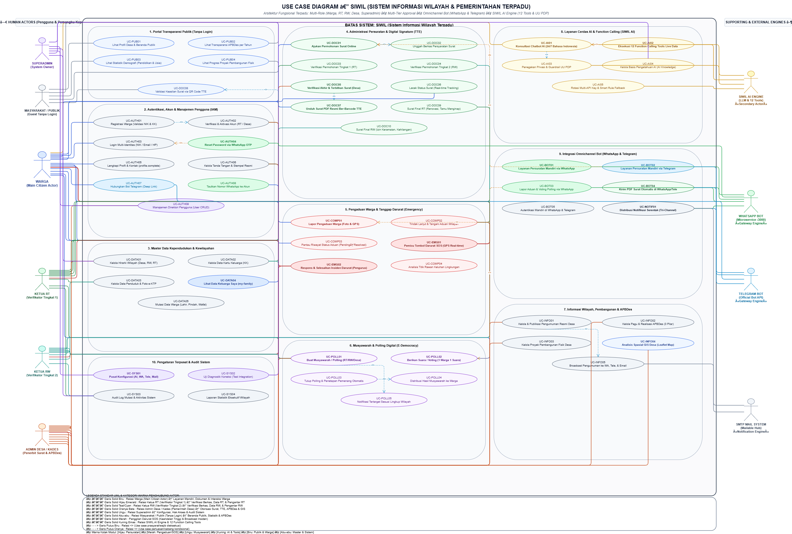
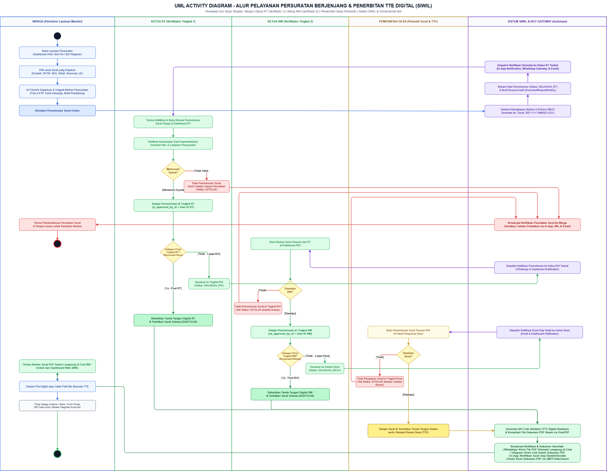
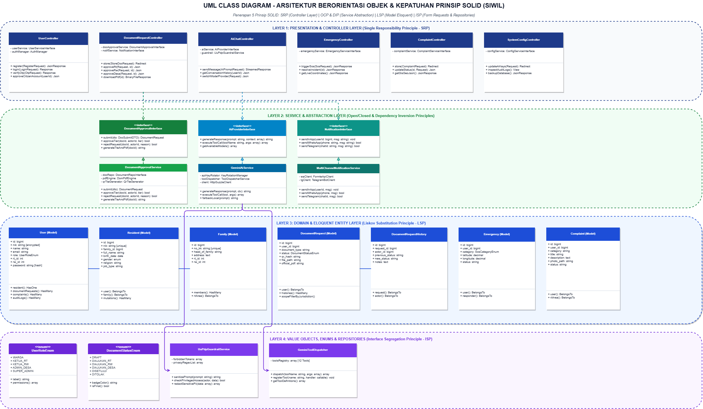
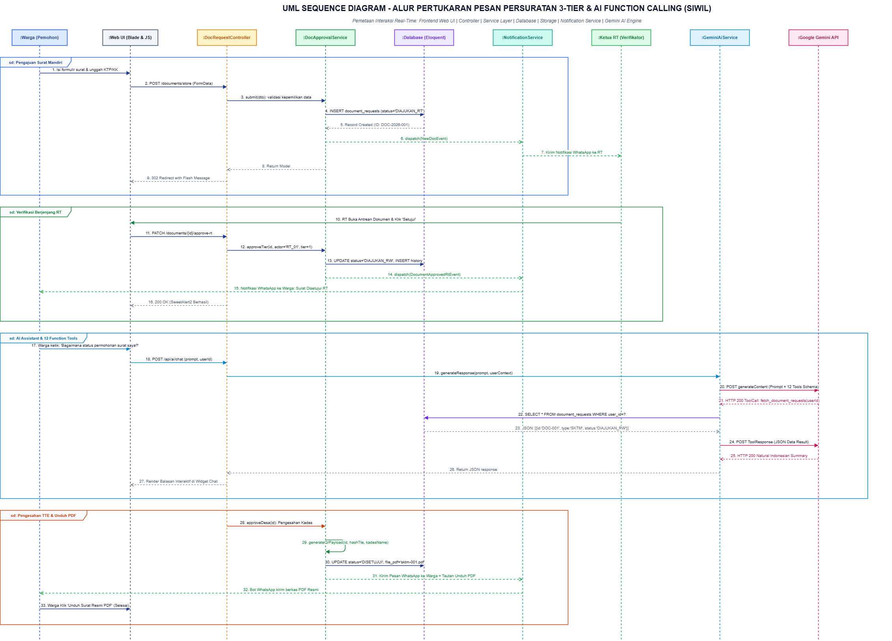
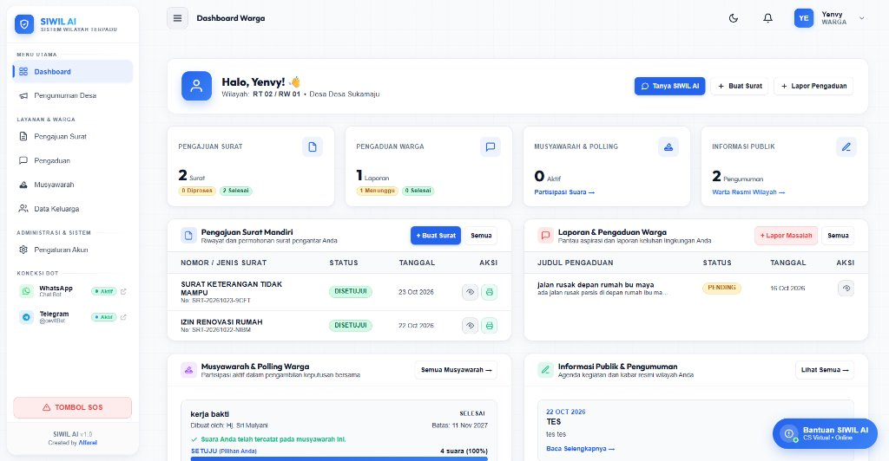
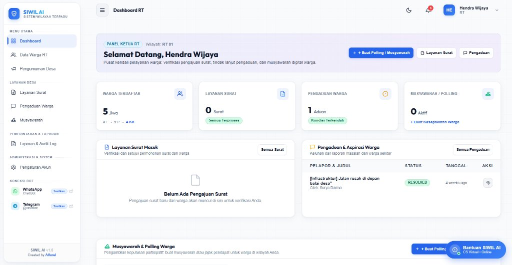
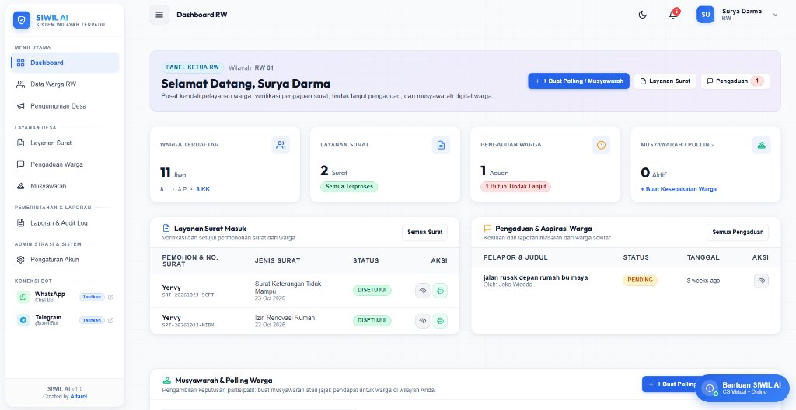
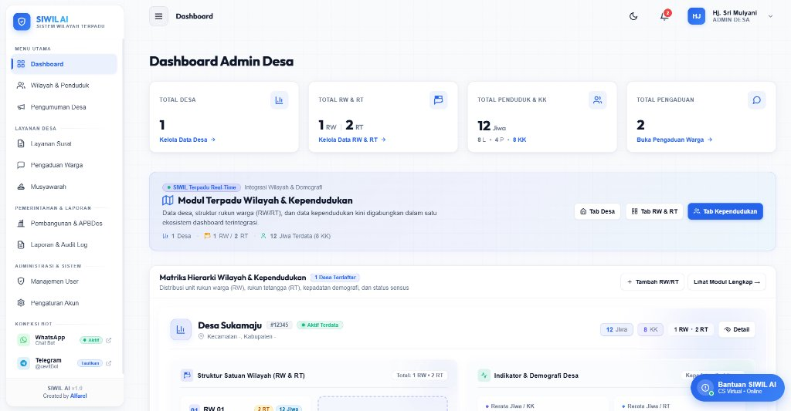

# BERKAS DIAGRAM ARSITEKTUR & PEMODELAN UML LENGKAP
## SIWIL — Sistem Informasi Wilayah & Pemerintahan Terpadu

---

### Informasi Metadata Dokumen
| Parameter | Keterangan Dokumen |
| :--- | :--- |
| **Aplikasi** | **SIWIL** (*Sistem Informasi Wilayah Terpadu*) |
| **Mata Kuliah** | **Rekayasa Perangkat Lunak (TIKB2503021) — Semester 3** |
| **Dosen Pengampu** | **Yudhistira Arie Wijaya, M.Kom., CDS.** |
| **Institusi** | **S1 Teknik Informatika — STMIK IKMI Cirebon** |
| **Nama Pengembang** | **Muhammad Al Farel** |
| **NIM** | **41257124** |
| **Kelas** | **TI 1B 2025** |
| **Tema Topik Kelompok** | **Smart Governance & E-Government Wilayah Desa, RW, dan RT Terpadu Berbasis AI & Omnichannel Bot** |
| **Standar Acuan** | **IEEE Std 1016-2009 (Software Design Descriptions) & UML 2.5 Specification** |

---

## DAFTAR ISI DIAGRAM

1. [Diagram 1: Use Case Diagram & Batasan Aktor RBAC](#1-use-case-diagram-sistem-siwil)
2. [Diagram 2: Activity Diagram Alur Persuratan 3-Tier & AI Workflow](#2-activity-diagram-alur-persuratan-3-tier--ai)
3. [Diagram 3: Class Diagram Berorientasi Objek (Penerapan 5 Prinsip SOLID)](#3-class-diagram-berorientasi-objek-prinsip-solid)
4. [Diagram 4: Sequence Diagram Pertukaran Pesan Antar-Komponen](#4-sequence-diagram-pertukaran-pesan-sistem--ai)
5. [Struktur Basis Data: Katalog 20 Entitas Relasional Basis Data](#5-struktur-basis-data-relasional-20-entitas)
6. [Diagram 5: Prototipe Desain Antarmuka & Dashboard Pengguna (UI/UX)](#6-prototipe-desain-antarmuka--dashboard-pengguna-uiux)

---

## 1. USE CASE DIAGRAM SISTEM SIWIL

Use Case Diagram menggambarkan interaksi fungsional antara seluruh pengguna sistem (*actors*) dengan modul-modul pada aplikasi SIWIL, menerapkan *Role-Based Access Control* (RBAC) yang ketat.

### Rincian Aktor & Wewenang Hak Akses:
1. **Publik / Tamu (Tanpa Login):**
   - Melihat Beranda Publik, Profil Desa, Struktur Organisasi, dan Pengumuman.
   - Mengakses Transparansi Realisasi APBDes (Anggaran Pendapatan dan Belanja Desa).
   - Melihat Statistik Demografi Penduduk & Proyek Pembangunan Desa (Peta Spasial GIS).
   - Registrasi Akun Warga Baru (Validasi Silang NIK & KK).
   - Permohonan Reset Password mandiri via kode OTP WhatsApp.
2. **Warga (Citizen):**
   - Mengakses Dashboard Mandiri Warga & Profil Kependudukan Terdaftar.
   - Mengajukan Permohonan Surat Resmi (Pengantar KTP, SKCK, SKTM, SKU, Domisili, dll).
   - Melacak Status Persuratan 3-Tier & Mengunduh Dokumen PDF Ber-TTE QR Code.
   - Menyampaikan Laporan Pengaduan Lingkungan disertai Foto Bukti & Koordinat GPS (*Geotagging*).
   - Mengaktifkan Tombol Darurat (**SOS Alert**) untuk insiden Medis, Bencana, Kebakaran, Kriminal.
   - Mengikuti Musyawarah Warga & Menyalurkan Suara pada Polling Terarah (*One Citizen One Vote*).
   - Berinteraksi dengan Asisten Cerdas **SIWIL AI** (Floating Chatbot).
   - Mengakses layanan mandiri melalui Bot WhatsApp & Bot Telegram resmi.
3. **Ketua RT (Rukun Tetangga):**
   - Verifikasi & Persetujuan Akun Pendaftaran Warga Baru di wilayah RT-nya.
   - Verifikasi Tahap 1 (Tier-1) Permohonan Surat Pengantar Warga RT.
   - Membubuhkan Tanda Tangan Elektronik (TTE) & Stempel Resmi RT pada dokumen surat.
   - Memantau & Menindaklanjuti Pengaduan Warga tingkat RT.
   - Menerima Sinyal Darurat SOS Warga RT secara instan pada Dashboard RT.
   - Membuat Polling / Musyawarah terarah khusus warga RT.
   - Mengelola Data Warga & Kartu Keluarga (KK) di lingkungan RT.
4. **Ketua RW (Rukun Warga):**
   - Verifikasi Tahap 2 (Tier-2) Permohonan Surat Warga dari seluruh RT di lingkungan RW.
   - Membubuhkan TTE & Stempel Resmi RW.
   - Mengelola Data Wilayah RT di bawah naungan RW.
   - Memantau Penanganan Aduan & Polling Tingkat RW.
5. **Admin Desa / Aparatur Kelurahan:**
   - Verifikasi Tahap Akhir (Tier-3) Penerbitan Surat Resmi Pemerintahan Desa.
   - Membubuhkan TTE Kepala Desa & Stempel Basah Digital Desa.
   - Menghasilkan Dokumen PDF Ber-QR Code Validator berkekuatan hukum.
   - Mengelola Master Data Wilayah (RW, RT), Penduduk (Dukcapil Desa), dan Kartu Keluarga.
   - Mengelola Transparansi APBDes, Realisasi Belanja, dan Titik Proyek Pembangunan.
   - Menerbitkan Pengumuman Resmi Desa yang disiarkan otomatis ke WhatsApp, Telegram, dan Email.
6. **Super Administrator:**
   - Manajemen Pengguna Global & Penetapan Peran (*Role Assignment*).
   - Mengatur Konfigurasi Terpusat Sistem (Kredensial AI API, WhatsApp Gateway, Telegram Bot, SMTP).
   - Mengelola Basis Pengetahuan AI (*AiKnowledge*) untuk panduan regulasi desa.
   - Mengakses Rekam Jejak Forensik Seluruh Aktivitas Sistem (*Audit Logs*).

---

## 2. ACTIVITY DIAGRAM ALUR PERSURATAN 3-TIER & AI

Activity Diagram memvisualisasikan alur proses bisnis persuratan nirkertas (*paperless governance*) berjenjang dan alur interaksi cerdas asisten AI.

### Alur Aktivitas Persuratan 3-Tier:
1. **Inisiasi Permohonan (Warga):**
   - Warga login ke sistem SIWIL (Web, WhatsApp Bot, atau Telegram Bot).
   - Warga memilih jenis surat (contoh: *Surat Keterangan Pengantar*, *SKU*, *SKTM*), mengisi keperluan/catatan, dan mengunggah dokumen pendukung bila disyaratkan.
   - Sistem memvalidasi data dan menerbitkan Nomor Registrasi Surat unik (contoh: `REQ-202611-0001`). Status awal: `DIAJUKAN_RT`.
2. **Verifikasi Tingkat 1 (Ketua RT):**
   - Ketua RT menerima notifikasi instan.
   - Ketua RT memeriksa keabsahan domisili dan data pemohon.
   - *Opsi Penolakan:* Jika ditolak, RT wajib memasukkan alasan penolakan, status menjadi `DITOLAK`, dan warga menerima notifikasi.
   - *Opsi Persetujuan:* Jika disetujui, RT membubuhkan TTE digital. Status berpindah ke `DIAJUKAN_RW`.
3. **Verifikasi Tingkat 2 (Ketua RW):**
   - Ketua RW memeriksa berkas yang telah diverifikasi RT.
   - Jika disetujui, RW membubuhkan TTE digital. Status berpindah ke `DIAJUKAN_DESA`.
   - *(Catatan: Untuk surat tertentu yang cukup sampai tingkat RW, proses dapat langsung selesai).*
4. **Verifikasi Tingkat 3 & Penerbitan Dokumen (Kantor Desa):**
   - Petugas Desa / Kepala Desa memvalidasi berkas final.
   - Saat Kepala Desa menekan *Approve*, sistem meng-generate **QR Code TTE Validator** berbasis URL verifikasi publik yang terenkripsi.
   - Library **DomPDF** merender format surat resmi desa lengkap dengan logo garuda/desa, kop resmi, data pemohon, stempel transparan, dan QR Code TTE.
   - Status surat berubah menjadi `DISETUJUI` / `SELESAI`.
   - Sistem mengirimkan file PDF otomatis ke nomor WhatsApp dan akun Telegram warga secara real-time.

---

## 3. CLASS DIAGRAM BERORIENTASI OBJEK (PRINSIP SOLID)

Class Diagram memodelkan struktur kelas, service, model domain, atribut, visibilitas, tipe data kembalian, dan relasi dependensi perangkat lunak yang mematuhi **5 Prinsip Desain SOLID**.

### Pemetaan 5 Prinsip SOLID pada Arsitektur SIWIL:
1. **Single Responsibility Principle (SRP):**
   - Setiap kelas hanya memiliki satu tanggung jawab spesifik.
   - `DocumentRequestService` hanya menangani logika siklus hidup surat; `AiToolService` hanya menangani kalkulasi function calling AI; `WhatsAppService` hanya menangani komunikasi gateway WhatsApp; `ResidentService` hanya menangani operasi kependudukan.
2. **Open/Closed Principle (OCP):**
   - Desain sistem terbuka terhadap penambahan fitur baru tanpa memodifikasi kode inti yang sudah stabil.
   - Penambahan model LLM baru (OpenAI, Gemini, Groq, DeepSeek) atau channel komunikasi baru (Email, WA, Telegram) dilakukan dengan mengimplementasikan antarmuka driver tanpa mengubah logika bisnis controller.
3. **Liskov Substitution Principle (LSP):**
   - Seluruh model domain mewarisi kontrak `Illuminate\Database\Eloquent\Model` dengan integritas tipe data, UUID primary keys, dan encapsulation attribute casting tanpa merusak fungsionalitas induk.
4. **Interface Segregation Principle (ISP):**
   - Antarmuka komunikasi dipecah menjadi modul-modul ramping spesifik (kontrak bot WhatsApp terpisah dari kontrak bot Telegram), mencegah pemaksaan implementasi method yang tidak relevan.
5. **Dependency Inversion Principle (DIP):**
   - Controller tingkat tinggi tidak bergantung langsung pada implementasi konkrit tingkat rendah, melainkan diinjeksi melalui *Laravel Service Container* (`constructor property promotion`).

---

## 4. SEQUENCE DIAGRAM PERTUKARAN PESAN SISTEM & AI

Sequence Diagram menggambarkan urutan kronologis pertukaran pesan (*message flows*) antar-objek pada dua transaksi inti sistem: **Penerbitan Surat Resmi Ber-QR Code** dan **Eksekusi Percakapan Cerdas dengan 12 Backend Tools AI**.

### Rincian Alur Pertukaran Pesan (Sequence Flow):
1. **Alur Percakapan Cerdas Asisten AI (Google Gemini LLM):**
   - `Warga` mengirimkan pesan percakapan melalui antarmuka web / bot ke `AiController`.
   - `AiController` mengautentikasi sesi dan mengecek *Instant Fast-Path Filter* (kueri lokal berlatensi < 10ms).
   - Jika membutuhkan penalaran bahasa alami, `AiController` memanggil `AiService` dengan menyertakan instruksi sistem terproteksi **UU PDP Guardrails**.
   - `AiService` meneruskan payload dan 12 skema tool ke **Google Gemini API**.
   - Google Gemini memutuskan kebutuhan data dan merespons dengan deklarasi *Function Calling* (misal: `call: fetch_document_requests`).
   - `AiToolService` mengeksekusi function calling secara aman ke basis data MySQL/SQLite menggunakan *scoped query* berdasar peran pemohon.
   - Hasil data riil dikembalikan ke Gemini API untuk disintesis menjadi jawaban bahasa Indonesia yang ramah, akurat, dan solutif.
   - `AiController` mengembalikan respons akhir dalam format JSON terstruktur ke antarmuka pengguna.
2. **Alur Transaksi Penerbitan Surat & QR TTE:**
   - `Admin Desa` menekan tombol *Setujui Permohonan* pada dashboard.
   - `DocumentRequestController` meneruskan instruksi ke `DocumentRequestService`.
   - `DocumentRequestService` mengunci transaksi basis data (`DB::transaction`), mengupdate status berkas menjadi `DISETUJUI`, dan membuat riwayat log pada tabel `document_request_histories`.
   - `DocumentRequestService` memanggil generator kode verifikasi TTE dan merender QR Code.
   - `DocumentRequestService` memanggil **DomPDF Wrapper** untuk mengompilasi tampilan Blade template menjadi dokumen PDF biner.
   - Berkas PDF disimpan ke direktori storage aman dan dihubungkan ke record database.
   - `Event/Notification Dispatcher` memicu notifikasi multi-kanal: email dikirim via SMTP, pesan ringkasan & dokumen PDF dikirim otomatis via `WhatsAppService` (port 3000) dan `TelegramService`.

---

## 5. STRUKTUR BASIS DATA RELASIONAL (20 ENTITAS)

Basis Data SIWIL memetakan 20 entitas tabel relasional beserta relasi kardinalitasnya (`1:N`, `N:M`, `1:1`) dengan integritas referensial dan UUID v4 primary keys.

### Struktur 20 Entitas Relasional Basis Data:
1. **Entitas Teritorial & Kewilayahan:**
   - `villages` (Data Master Desa/Kelurahan).
   - `rws` (Data Rukun Warga, *foreign key* `village_id`).
   - `rts` (Data Rukun Tetangga, *foreign key* `rw_id`).
2. **Entitas Kependudukan & Kartu Keluarga:**
   - `families` (Data Kartu Keluarga, nomor KK, alamat, *foreign key* `rt_id`).
   - `residents` (Biodata Penduduk, NIK, nama, jenis kelamin, TTL, pekerjaan, *foreign key* `family_id`, `rt_id`).
   - `users` (Akun Login Pengguna, username NIK, password Bcrypt, role Spatie, status akun, *foreign key* `resident_id`).
3. **Entitas Pelayanan Persuratan & Legalisasi:**
   - `document_requests` (Permohonan Surat, nomor surat, jenis, keperluan, status approval, tanda tangan RT/RW/Desa, QR verification code).
   - `document_request_histories` (Catatan audit jejak status verifikasi surat per level pejabat).
4. **Entitas Partisipasi, Aduan & Kedaruratan:**
   - `complaints` (Laporan Pengaduan Warga, judul, deskripsi, foto bukti, koordinat GPS geotagging, status penanganan).
   - `emergencies` (Sinyal Darurat SOS, tipe insiden, koordinat GPS, status penanganan pengurus).
   - `polls` (Agenda Musyawarah/Polling, judul, batas waktu, level wilayah RT/RW/Desa).
   - `poll_options` (Pilihan jawaban polling).
   - `poll_votes` (Rekam hak pilih warga — relasi unik mencegah *double voting*).
5. **Entitas Transparansi Fiskal & Tata Kelola:**
   - `budgets` (Pencatatan APBDes per tahun, pos pendapatan, belanja, pembiayaan, pagu anggaran, realisasi serapan).
   - `developments` (Proyek Pembangunan Fisik, nama proyek, lokasi peta, persentase kemajuan, foto progres).
   - `announcements` (Edaran dan Pengumuman Resmi Desa).
6. **Entitas Sistem, Notifikasi & AI:**
   - `app_notifications` (Pusat notifikasi internal in-app multi-user).
   - `audit_logs` (Rekam audit forensik keamanan mutasi data sensitif sistem, *append-only*).
   - `ai_knowledge` (Basis pengetahuan kependudukan, profil desa, dan SOP layanan untuk referensi AI).
   - `system_configurations` (Penyimpanan dinamis kredensial AI, bot WhatsApp, bot Telegram, dan SMTP).

---

## 6. PROTOTIPE DESAIN ANTARMUKA & DASHBOARD PENGGUNA (UI/UX)

Antarmuka SIWIL dirancang menggunakan prinsip **Mobile-First Responsive Design** berbasis **Tailwind CSS v4** dengan tema adaptif (*Dark / Light Mode*) dan navigasi ramah sentuhan (*touch-friendly bottom navigation*).

### 6.1 Dashboard Warga (Citizen Portal)
Menyajikan status permohonan surat terkini, tombol pemicu SOS darurat, akses polling musyawarah warga, dan floating chatbot SIWIL AI.

---

### 6.2 Dashboard Ketua RT (Rukun Tetangga)
Menyajikan antrean verifikasi surat warga tingkat 1, data kependudukan RT, peringatan insiden darurat SOS aktif, dan pengelolaan aduan warga lingkungan RT.

---

### 6.3 Dashboard Ketua RW (Rukun Warga)
Menyajikan rekapitulasi verifikasi surat tingkat 2, agregasi statistik wilayah RW, pengawasan proyek pembangunan, dan penanganan aduan tingkat RW.

---

### 6.4 Dashboard Pemerintahan Desa / Super Admin
Menyajikan pusat kendali legalisasi surat resmi desa, visualisasi ringkasan APBDes tahunan, direktori penduduk desa, pengelolaan pengumuman serentak, konfigurasi terpusat sistem, dan audit log forensik.

---

*Dokumen Diagram Arsitektur & Pemodelan UML ini disusun secara lengkap dan presisi oleh Muhammad Al Farel (NIM: 41257124) sebagai bagian tak terpisahkan dari luaran proyek akhir mata kuliah Rekayasa Perangkat Lunak.*
