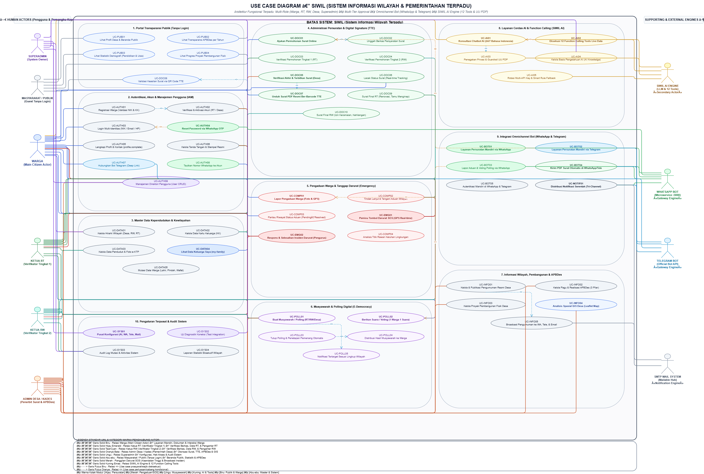
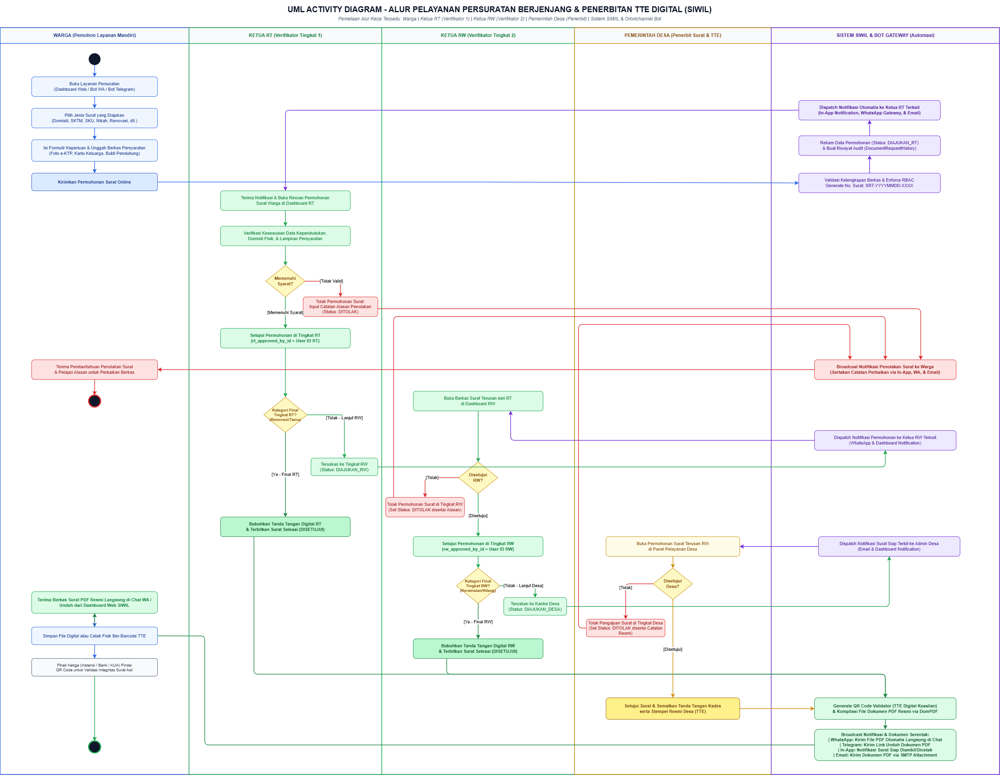
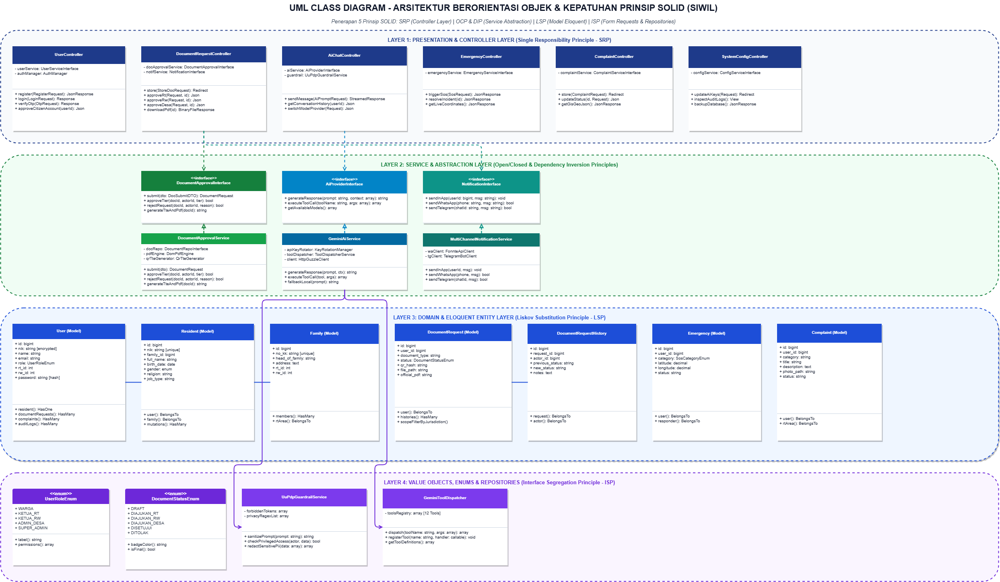

# LAPORAN AKHIR PROYEK REKAYASA PERANGKAT LUNAK (FINAL INTEGRATED REPORT)
## SIWIL — Sistem Informasi Wilayah & Pemerintahan Terpadu Berbasis AI & Omnichannel
### Standar Dokumentasi: IEEE Std 830-1998 (PRD/SRS), IEEE Std 1016-2009 (SDD), ISO/IEC 25010 (NFR), & Panduan Kurikulum OBE

---

### Informasi Metadata Laporan & Mahasiswa
| Atribut Dokumen | Rincian Keterangan |
| :--- | :--- |
| **Judul Proyek** | **SIWIL** (*Sistem Informasi Wilayah Terpadu*) |
| **Mata Kuliah** | **Rekayasa Perangkat Lunak (TIKB2503021)** — 4 SKS |
| **Dosen Pengampu** | **Yudhistira Arie Wijaya, M.Kom., CDS.** |
| **Nama Mahasiswa** | **Muhammad Al Farel** |
| **NIM** | **41257124** |
| **Kelas** | **TI 1B 2025** |
| **Program Studi** | **S1 Teknik Informatika (TI)** |
| **Institusi** | **STMIK IKMI Cirebon** |
| **Tema / Topik** | **Smart Governance & E-Government Wilayah Desa, RW, dan RT Berbasis AI & Omnichannel Bot** |
| **Tahun Akademik** | **2025 / 2026** |
| **Repositori GitHub** | `https://github.com/Yenvys/SistemWilayah.git` |
| **Tautan Video Demo** | `https://youtu.be/0H_HhHe1bR4?si=PfxTpZPErlz5iVDC` (Progres 1, Progres 2, & Final Live Demo) |
| **Status Pengujian** | **105 Tests Passed (540 Assertions), 100% Code Quality (Pint Passed)** |

---

## RINGKASAN EKSEKUTIF (EXECUTIVE SUMMARY)

Laporan Akhir Terpadu (*Single Master PDF Deliverable*) ini menyajikan dokumentasi komprehensif pengembangan sistem perangkat lunak **SIWIL (Sistem Informasi Wilayah Terpadu)**. Dokumen ini dirancang dan dijilid menjadi satu kesatuan utuh tanpa reduksi materi untuk memenuhi ketentuan pengumpulan Bab V Panduan Proyek Akhir Mata Kuliah Rekayasa Perangkat Lunak:
1. **Tahap 1: Inisiasi & Spesifikasi Kebutuhan Perangkat Lunak (PRD / SRS Mandiri):** Disusun berdasarkan standar **IEEE Std 830-1998** dan **ISO/IEC/IEEE 29148:2018**, mendefinisikan 10 profil aktor sistem (6 aktor manusia & 4 gateway otomasi), 12 modul kebutuhan fungsional (FR-01 s.d FR-12) dengan 17 User Stories lengkap berformat kriteria penerimaan Gherkin (*Given-When-Then*), spesifikasi arsitektur AI terintegrasi Google Gemini dengan 12 native function calling tools deterministik, batasan hukum kepatuhan privasi UU No. 27 Tahun 2022 tentang Perlindungan Data Pribadi (UU PDP), kebutuhan non-fungsional berstandar **ISO/IEC 25010**, dan Matriks Ketertelusuran Kebutuhan (*Requirements Traceability Matrix* / RTM).
2. **Tahap 2: Perancangan Arsitektur Sistem & SDD (IEEE Std 1016-2009 & UML 2.5):** Memodelkan arsitektur perangkat lunak dengan pendekatan Clean Architecture dan 5 Prinsip Desain SOLID, mencakup 4 diagram UML utama lengkap (*Use Case Diagram & 10 Tabel Skenario Aktor, Activity Diagram alur bisnis 3-tier & alur inferensi AI, Class Diagram berorientasi objek, dan Sequence Diagram pertukaran pesan transaksi & AI*), perancangan Entity Relationship Diagram (ERD) 20 entitas basis data ternormalisasi (3NF), serta cetak biru desain UI/UX mobile-first dengan Tailwind CSS v4.
3. **Tahap 3: Konstruksi Kode, Integrasi AI, Testing & CI/CD Pipeline:** Mengimplementasikan kode program berbasis Laravel 11 / PHP 8.5 dan MySQL 8.4, membangun 105 skrip pengujian otomatis (Unit & Feature Tests via PHPUnit) dengan 540 assertions (100% lolos), penegakan gaya kode otomatis (Laravel Pint), serta orkestrasi pipeline otomatisasi CI/CD pada GitHub Actions (`.github/workflows/ci.yml`).
4. **Tahap 4: Evaluasi Luaran, Live Demo, dan Penutup:** Menyajikan analisis komparatif dampak sistem terhadap birokrasi wilayah, evaluasi ketercapaian rubrik Outcome-Based Education (OBE), penayangan live demo multi-peran (Warga, Ketua RT, Ketua RW, Admin Desa, Super Admin), serta pernyataan orisinalitas karya mandiri.

---

## BAB I: PENDAHULUAN & LATAR BELAKANG MASALAH

### 1.1 Masalah Riil Tata Kelola Wilayah
Birokrasi pemerintahan desa dan rukun kemasyarakatan (RT/RW) di Indonesia merupakan pilar pelayanan publik terdepan. Namun, dalam operasionalisasinya masih terdapat kendala fundamental:
1. **Rantai Birokrasi Manual & Lambat:** Warga harus secara fisik mendatangi rumah Ketua RT untuk meminta surat pengantar basah, dilanjutkan ke rumah Ketua RW, lalu mengantre di kantor kelurahan/desa. Proses ini memakan waktu 2 hingga 5 hari kerja hanya untuk satu lembar surat keterangan.
2. **Asimetri Ketersediaan Waktu Pengurus:** Ketua RT dan RW adalah tokoh masyarakat yang memiliki pekerjaan utama di luar perannya, menyulitkan warga untuk bertemu langsung dan memperoleh tanda tangan secara fleksibel.
3. **Kerentanan Privasi Data (Pelanggaran UU PDP No. 27/2022):** Buku register kependudukan manual rawan tercecer dan memaparkan NIK, tanggal lahir, serta susunan keluarga kepada khalayak umum tanpa mekanisme pembatasan hak akses (*access control*).
4. **Minimnya Transparansi APBDes & Partisipasi Warga:** Partisipasi warga dalam musyawarah lingkungan sangat rendah (hanya 15%-25%), dan informasi realisasi anggaran pendapatan dan belanja desa (APBDes) sulit diakses secara transparan oleh publik.

### 1.2 Solusi Inovatif SIWIL
SIWIL menghadirkan platform cerdas terpadu dengan nilai kebaruan (*novelty*):
- **Pelayanan Persuratan Nirkertas 3-Tier:** Alur persetujuan RT $\to$ RW $\to$ Desa terotomasi secara digital dengan legalitas berkekuatan hukum menggunakan Tanda Tangan Elektronik (TTE) berbasis QR Code verifikasi.
- **Validasi Silang Kependudukan (Zero Fake Account):** Pendaftaran warga memvalidasi kecocokan NIK dan No. KK terhadap basis data kependudukan desa secara otomatis sebelum akun diaktifkan.
- **Asisten Cerdas SIWIL AI:** Berbasis Google Gemini LLM yang terintegrasi langsung dengan 12 tools backend untuk mengambil data riil wilayah dengan batasan ketat proteksi privasi UU PDP.
- **Kanal Omnichannel Inklusif:** Layanan dapat diakses melalui portal web, bot WhatsApp resmi (microservice port 3000), dan bot Telegram resmi.

---

## BAB II: SPESIFIKASI KEBUTUHAN SISTEM (PRD / SRS LENGKAP - IEEE 830 & ISO 29148)

### 2.1 Tujuan & Ruang Lingkup Produk
Dokumen spesifikasi kebutuhan ini disusun berstandar **IEEE Std 830-1998** dan **ISO/IEC/IEEE 29148:2018** untuk merancang, membangun, menguji, dan memvalidasi aplikasi web utuh **SIWIL (Sistem Informasi Wilayah Terpadu)**.

Ruang lingkup sistem mencakup:
1. **Administrasi Kependudukan Berjenjang:** Pendataan penduduk, Kartu Keluarga (KK), dan relasi kewilayahan hierarkis (Desa $\to$ RW $\to$ RT).
2. **Layanan Persuratan Digital 3-Tier:** Pengajuan mandiri oleh warga, verifikasi berjenjang (RT $\to$ RW $\to$ Desa), pembubuhan tanda tangan dan stempel dinas digital otomatis, serta penerbitan vector PDF resmi ber-QR Code.
3. **Partisipasi Warga & Respons Cepat:** Pelaporan aduan terkoordinat GPS dan foto bukti fisik, tombol darurat satu sentuhan (*SOS Panic Button*), dan jajak pendapat digital (*E-Voting*).
4. **Transparansi Tata Kelola:** Publikasi terbuka APBDes per tahun anggaran dan progres pembangunan fisik berbasis Sistem Informasi Geografis (GIS).
5. **Aksesibilitas Multikanal (Omnichannel):** Layanan mandiri via WhatsApp Bot dan Telegram Bot resmi.
6. **Kecerdasan Artifisial (SIWIL AI):** Agen interaktif berbasis Google Gemini LLM yang dilengkapi 12 *native function calling tools* dan filter keamanan privasi sesuai UU No. 27 Tahun 2022 tentang Perlindungan Data Pribadi (UU PDP).

### 2.2 Definisi, Akronim, dan Singkatan
* **SRS:** *Software Requirements Specification* (Dokumen Spesifikasi Kebutuhan Perangkat Lunak).
* **PRD:** *Product Requirement Document* (Dokumen Kebutuhan Produk).
* **RBAC:** *Role-Based Access Control* (Pembatasan hak akses berbasis peran pengguna).
* **NIK:** Nomor Induk Kependudukan (16 digit angka identitas penduduk Indonesia).
* **KK:** Kartu Keluarga (16 digit angka identitas keluarga Indonesia).
* **UU PDP:** Undang-Undang Republik Indonesia No. 27 Tahun 2022 tentang Perlindungan Data Pribadi.
* **LLM:** *Large Language Model* (Model bahasa besar kecerdasan artifisial, contoh: Google Gemini).
* **RAG:** *Retrieval-Augmented Generation* (Teknik augmentasi konteks AI dari basis data pengetahuan lokal).
* **OTP:** *One-Time Password* (Kode sandi sekali pakai untuk autentikasi).
* **GIS:** *Geographic Information System* (Sistem informasi berbasis pemetaan geografis).
* **SKTM / SKU / SKW:** Surat Keterangan Tidak Mampu / Usaha / Waris.

### 2.3 Profil 10 Aktor Sistem (User Personas)
Sistem memodelkan **10 Aktor Sistem** yang terbagi menjadi **6 Aktor Primer (Pengguna Manusia)** dan **4 Aktor Sekunder (Sistem Pendukung & Gateway Otomasi)**:

| ID Aktor | Nama Peran | Kategori Aktor | Deskripsi Karakteristik & Kebutuhan Inti |
| :--- | :--- | :--- | :--- |
| **ACT-01** | **Warga (Citizen)** | Primer (Manusia) | Masyarakat umum domisili RT/RW yang menginginkan kemudahan pengurusan surat nirkertas tanpa antre fisik, pelaporan aduan lingkungan cepat, pemantauan kegiatan musyawarah, dan akses tombol darurat SOS. Mengakses via web mobile, bot WhatsApp, dan Telegram. |
| **ACT-02** | **Pengurus RT (Ketua RT)** | Primer (Manusia) | Tokoh masyarakat pengurus RT yang memiliki profesi utama di luar. Memerlukan meja kerja digital dan sistem notifikasi instan saat ada warga mendaftar, berkas surat yang perlu diverifikasi awal, atau situasi darurat di lingkungannya. |
| **ACT-03** | **Pengurus RW (Ketua RW)** | Primer (Manusia) | Koordinator lingkungan tingkat RW yang memvalidasi persetujuan surat berjenjang antar-RT, mengesahkan izin kegiatan lingkungan, dan memantau agregat demografi serta disparitas antar-RT. |
| **ACT-04** | **Admin Desa / Kelurahan** | Primer (Manusia) | Aparatur sipil kantor desa yang bertanggung jawab penuh terhadap legalitas surat dinas desa (Tanda Tangan Elektronik), penatausahaan APBDes, inventarisasi proyek fisik pembangunan, dan sosialisasi warta resmi desa. |
| **ACT-05** | **Super Admin** | Primer (Manusia) | Administrator teknis yang bertugas mengelola siklus hidup akun pengguna, konfigurasi runtime (kredensial API Key AI, WhatsApp gateway, SMTP), pemeliharaan master wilayah, dan audit logging sistem. |
| **ACT-06** | **Pengunjung Publik** | Primer (Manusia) | Masyarakat luas yang ingin melihat transparansi penyelenggaraan desa (profil wilayah, realisasi APBDes, status pembangunan fisik, dan statistik terbuka tanpa perlu login). |
| **ACT-07** | **SIWIL AI Agent** | Sekunder (Mesin/AI) | Entitas kecerdasan buatan otonom berbasis LLM Google Gemini yang berperan sebagai asisten virtual 24/7 untuk menjawab pertanyaan administrasi dan mengeksekusi operasi data melalui function calling berbatas izin (*read-only tools* & guardrails UU PDP). |
| **ACT-08** | **WhatsApp Bot Gateway** | Sekunder (Gateway) | Layanan bot percakapan instan WhatsApp multi-device (Baileys / Node.js port 3000) yang bertindak sebagai antarmuka omnichannel warga untuk mengecek status surat, menerima notifikasi darurat SOS, dan mempermudah warga yang tidak terbiasa dengan antarmuka web. |
| **ACT-09** | **Telegram Bot Gateway** | Sekunder (Gateway) | Kanal bot resmi Telegram (`@cevilBot` / API Gateway) untuk penyiaran pengumuman resmi desa, penerusan peringatan dini bencana/keamanan lingkungan, dan alternatif kanal interaksi dua arah dengan sistem. |
| **ACT-10** | **SMTP Mail System** | Sekunder (Mail Engine) | Layanan mail transfer agent (SMTP) untuk pengiriman surat elektronik resmi, pengiriman tautan verifikasi akun/reset kata sandi, lampiran dokumen PDF ber-TTE ke instansi eksternal, dan notifikasi audit keamanan sistem. |

### 2.4 Batasan Perancangan & Asumsi Ketergantungan
1. **Bahasa Pemrograman & Framework:** PHP 8.5 menggunakan framework Laravel LTS dengan struktur arsitektur MVC, Service Layer, dan Repository Pattern.
2. **Tipe Data Primary Key:** Wajib menggunakan format UUID v4 (`HasUuids`) di seluruh entitas basis data untuk memitigasi risiko *Insecure Direct Object Reference* (IDOR).
3. **Regulasi Perlindungan Privasi:** Wajib mematuhi amanat UU No. 27 Tahun 2022 tentang Perlindungan Data Pribadi (UU PDP). NIK, alamat lengkap, dan nomor kontak dilindungi oleh pembatasan akses data (*scopeAccessibleBy*).
4. **Kemandirian Modul AI:** Integrasi AI tidak boleh menimbulkan ketergantungan fatal (*single point of failure*). Jika API Key pihak ketiga mengalami gangguan, aplikasi tetap berfungsi normal melalui mekanisme rotasi multi-key dan *rule-based smart fallback*.

---

### 2.5 Spesifikasi Kebutuhan Fungsional (FR-01 s.d FR-12) & 17 User Stories

#### FR-01: Autentikasi & Pre-Enrollment NIK Terverifikasi
* **ID Kebutuhan:** `REQ-F-001`
* **User Story:** *Sebagai warga baru, saya ingin melakukan registrasi akun menggunakan NIK dan No. KK saya, sehingga akun saya terverifikasi secara resmi dengan data kependudukan RT.*
* **Kriteria Penerimaan (Acceptance Criteria):**
  * **Skenario 1.1: Registrasi Berhasil (Data Valid & Terdaftar di Database RT)**
    * **Given** Warga memasukkan 16 digit NIK dan No. KK yang telah diinput sebelumnya oleh Ketua RT.
    * **When** Warga mengisi password (min. 6 karakter), nomor HP/WhatsApp, dan menekan tombol "Daftar".
    * **Then** Sistem membuat rekaman user baru dengan role `WARGA` dan status `pending`, lalu menampilkan pesan sukses bahwa akun sedang menunggu verifikasi RT/Admin.
  * **Skenario 1.2: Registrasi Ditolak (NIK Belum Terdaftar)**
    * **Given** Warga memasukkan NIK yang belum tercatat pada basis data kependudukan RT.
    * **When** Warga menekan tombol "Daftar".
    * **Then** Sistem menolak pendaftaran dan memberikan pesan galat: *"NIK tidak ditemukan di data kependudukan. Pastikan RT/RW Anda sudah mendaftarkan NIK Anda."*
  * **Skenario 1.3: Login Akun Menunggu Verifikasi**
    * **Given** Warga memiliki akun berstatus `pending`.
    * **When** Warga mencoba login menggunakan NIK dan password yang benar.
    * **Then** Sistem menolak sesi login dan menampilkan pesan: *"Akun Anda masih menunggu verifikasi oleh RT/Admin."*

#### FR-02: Pemulihan Akun via OTP WhatsApp
* **ID Kebutuhan:** `REQ-F-002`
* **User Story:** *Sebagai pengguna yang lupa kata sandi, saya ingin menerima kode OTP verifikasi melalui pesan WhatsApp resmi sistem, sehingga saya dapat mereset kata sandi dengan aman tanpa email konvensional.*
* **Kriteria Penerimaan (Acceptance Criteria):**
  * **Skenario 2.1: Permintaan OTP Berhasil**
    * **Given** Pengguna memasukkan NIK, email, atau nomor HP yang terdaftar aktif.
    * **When** Pengguna mengklik tombol "Kirim Kode OTP".
    * **Then** Sistem menggenerasi 6 digit angka acak kriptografis, menyimpannya di Cache terenkripsi selama 10 menit, menyetel *cooldown* 60 detik, dan mengirimkan pesan WhatsApp ke nomor pengguna.
  * **Skenario 2.2: Pembatasan Frekuensi Permintaan (*Rate Limiting*)**
    * **Given** Pengguna telah meminta kode OTP kurang dari 60 detik yang lalu.
    * **When** Pengguna menekan tombol "Kirim Ulang".
    * **Then** Sistem menolak pengiriman dan menampilkan sisa waktu tunggu dalam detik.
  * **Skenario 2.3: Verifikasi OTP Valid & Pembaruan Sandi**
    * **Given** Pengguna memasukkan kode 6-digit yang cocok dengan rekaman Cache.
    * **When** Pengguna memasukkan kata sandi baru dan menekan tombol "Simpan Kata Sandi".
    * **Then** Kata sandi di-hash menggunakan algoritma Bcrypt, OTP di-flush dari Cache, dan pengguna diarahkan ke halaman login dengan pesan sukses.

#### FR-03: Hierarki Wilayah & Administrasi Kependudukan
* **ID Kebutuhan:** `REQ-F-003`
* **User Story:** *Sebagai pengurus RT/RW/Desa, saya ingin mengelola data struktur wilayah dan kependudukan sesuai yurisdiksi saya, sehingga pencatatan mutasi penduduk (lahir, pindah, wafat) tersinkronisasi rapi.*
* **Kriteria Penerimaan (Acceptance Criteria):**
  * **Skenario 3.1: Hak Akses Data Sesuai Scope Wilayah (RBAC)**
    * **Given** Pengurus RT 01 login ke dalam sistem.
    * **When** Pengurus membuka menu data kependudukan.
    * **Then** Sistem hanya menampilkan daftar warga dan Kartu Keluarga yang berdomisili di RT 01. Warga RT 02 atau RW lain tidak terlihat (*strict data scoping*).
  * **Skenario 3.2: Penambahan Anggota Keluarga Baru**
    * **Given** Pengurus RT memilih data Kartu Keluarga tertentu.
    * **When** Pengurus menginput NIK, nama, tanggal lahir, jenis kelamin, hubungan keluarga, dan foto KTP fisik.
    * **Then** Sistem menyimpan rekaman penduduk baru berelasi dengan `family_id` yang sesuai dan mencatat aktivitas penambahan ke dalam `audit_logs`.

#### FR-04: Layanan Persuratan Berjenjang & Digital Signature
* **ID Kebutuhan:** `REQ-F-004`
* **User Story:** *Sebagai warga, saya ingin mengajukan surat administrasi (SKTM/SKU/Pengantar) secara online, dan sebagai pengurus saya ingin menyetujui serta membubuhkan tanda tangan digital secara bertingkat.*
* **Kriteria Penerimaan (Acceptance Criteria):**
  * **Skenario 4.1: Pengajuan Surat Tingkat RT**
    * **Given** Warga memilih jenis surat `IZIN_RENOVASI_RUMAH`.
    * **When** Warga mengunggah berkas lampiran dan mengirim pengajuan.
    * **Then** Dokumen dibuat dengan status `DIAJUKAN_RT`, dan sistem mendeteksi level approval final adalah `RT`.
  * **Skenario 4.2: Alur Persetujuan Berjenjang Surat Desa (Contoh: SKTM)**
    * **Given** Dokumen berstatus `DIAJUKAN_RT` dengan jenis `SURAT_KETERANGAN_TIDAK_MAMPU`.
    * **When** Ketua RT menekan "Setujui (Teruskan ke RW)".
    * **Then** Sistem mencatat stempel persetujuan RT (`rt_approved_by_id`), menyematkan tanda tangan RT, mengubah status menjadi `DIAJUKAN_RW`, serta mengirim notifikasi otomatis ke WhatsApp/Telegram Ketua RW.
    * **When** Ketua RW menyetujui, status berubah menjadi `DIAJUKAN_DESA` dan diteruskan ke Kantor Desa.
    * **When** Admin Desa/Kades menekan "Setujui & Terbitkan", status berubah menjadi `DISETUJUI / SELESAI`.

#### FR-05: Penerbitan Vector PDF & Verifikasi QR Code
* **ID Kebutuhan:** `REQ-F-005`
* **User Story:** *Sebagai pemohon yang suratnya disetujui, saya ingin mengunduh berkas surat dalam format PDF resmi berkop desa lengkap dengan stempel dinas, tanda tangan digital, dan QR Code verifikasi.*
* **Kriteria Penerimaan (Acceptance Criteria):**
  * **Skenario 5.1: Ekspor Dokumen Resmi DomPDF**
    * **Given** Pengajuan surat telah berstatus `DISETUJUI` atau `SELESAI`.
    * **When** Pengguna atau pengurus menekan tombol "Cetak PDF".
    * **Then** Sistem merender template Blade yang sesuai (`formats/desa.blade.php` atau `formats/rt_only.blade.php`), menyematkan nomor registrasi otomatis, stempel transparan, dan gambar TTD resmi.
  * **Skenario 5.2: Pemindaian QR Code Keabsahan**
    * **Given** Dokumen fisik dicetak oleh warga.
    * **When** Pihak ketiga (bank/instansi lain) memindai QR Code pada pojok bawah surat.
    * **Then** QR Code mengarah ke data verifikasi terenkripsi: `VERIFIED_SIWIL|NO:<request_number>|TGL:<date>|STATUS:DISETUJUI` yang membuktikan keaslian dokumen tanpa rekayasa.

#### FR-06: Pengaduan Warga Berbasis Spasial (GIS)
* **ID Kebutuhan:** `REQ-F-006`
* **User Story:** *Sebagai warga, saya ingin menyampaikan laporan keluhan kerusakan fasilitas lingkungan lengkap dengan foto dan titik lokasi peta GPS, sehingga pengurus dapat meninjau ke lokasi secara tepat.*
* **Kriteria Penerimaan (Acceptance Criteria):**
  * **Skenario 6.1: Pelaporan Aduan dengan Geotagging**
    * **Given** Warga berada di lokasi lampu jalan rusak.
    * **When** Warga membuka form aduan, mengizinkan akses GPS peramban (mendapatkan `location_lat` dan `location_lng`), mengunggah foto bukti, dan mengirimkan aduan.
    * **Then** Sistem menyimpan aduan dengan status `PENDING`, mengaitkannya ke wilayah RT/RW pelapor, dan menampilkannya sebagai pin koordinat di Peta Spasial Dashboard Desa.
  * **Skenario 6.2: Pembaruan Status Penanganan**
    * **Given** Pengurus RT/Desa meninjau aduan.
    * **When** Pengurus mengubah status menjadi `PROCESSING` lalu `RESOLVED`.
    * **Then** Sistem memperbarui status aduan dan mengirimkan pemberitahuan progres kepada warga pelapor.

#### FR-07: Tombol Darurat Satu Ketukan (SOS Panic Button)
* **ID Kebutuhan:** `REQ-F-007`
* **User Story:** *Sebagai warga yang menghadapi bahaya (medis darurat, kebakaran, kriminalitas), saya ingin menekan tombol SOS merah di dashboard/bot, sehingga pengurus wilayah terdekat segera mendapat sinyal bahaya berkoordinat.*
* **Kriteria Penerimaan (Acceptance Criteria):**
  * **Skenario 7.1: Pemicuan Alarm Darurat Aktif**
    * **Given** Warga membuka aplikasi dalam kondisi krisis.
    * **When** Warga menekan tombol "Kirim Panggilan Darurat" dan memilih tipe insiden (`Medis`, `Kebakaran`, `Kriminal`).
    * **Then** Sistem mencatat rekaman `emergencies` berstatus `ACTIVE` lengkap dengan koordinat GPS real-time.
  * **Skenario 7.2: Penyiaran Alarm Audio-Visual**
    * **Given** Terdapat sinyal SOS darurat berstatus `ACTIVE`.
    * **When** Pengurus RT, RW, atau Admin Desa membuka dashboard.
    * **Then** Sistem memunculkan banner peringatan darurat berwarna merah mencolok disertai koordinat lokasi dan identitas pelapor.
  * **Skenario 7.3: Penyelesaian Insiden Darurat**
    * **Given** Penanganan lapangan telah diselesaikan oleh satgas/pengurus.
    * **When** Pengurus menekan tombol "Selesaikan Darurat".
    * **Then** Status darurat berubah menjadi `RESOLVED` dan banner peringatan otomatis hilang.

#### FR-08: Musyawarah Digital & Polling Warga (E-Voting Scoped)
* **ID Kebutuhan:** `REQ-F-008`
* **User Story:** *Sebagai pengurus, saya ingin mengadakan musyawarah lingkungan berbasis e-voting berbatas wilayah, dan sebagai warga saya ingin memberikan suara secara rahasia dan sah.*
* **Kriteria Penerimaan (Acceptance Criteria):**
  * **Skenario 8.1: Pembuatan Polling Berskala RT**
    * **Given** Ketua RT 02 membuat polling jadwal kerja bakti.
    * **When** Polling disimpan dengan `rt_id` RT 02 dan batas kedaluwarsa waktu.
    * **Then** Polling hanya muncul pada daftar musyawarah warga RT 02. Warga RT 01 tidak dapat melihat maupun memilih.
  * **Skenario 8.2: Pencegahan Pemilihan Ganda (One Citizen One Vote)**
    * **Given** Warga telah memberikan 1 suara pada opsi pilihan polling.
    * **When** Warga mencoba mengklik dan memilih opsi lain kembali.
    * **Then** Sistem menolak dan menampilkan status bahwa hak suara pengguna telah tercatat.
  * **Skenario 8.3: Otomasi Penentuan Pemenang**
    * **Given** Masa aktif polling telah mencapai `expires_at`.
    * **When** Polling ditutup (`CLOSED`).
    * **Then** Sistem menghitung persentase suara terbesar secara matematis, menetapkan `winning_option`, dan menyiarkan hasil rekapitulasi ke WhatsApp warga.

#### FR-09: Transparansi Anggaran Desa (APBDes Digital)
* **ID Kebutuhan:** `REQ-F-009`
* **User Story:** *Sebagai masyarakat publik atau warga, saya ingin melihat rincian APBDes per tahun anggaran beserta perbandingan realisasinya, sehingga tata kelola keuangan desa transparan dan akuntabel.*
* **Kriteria Penerimaan (Acceptance Criteria):**
  * **Skenario 9.1: Inspeksi APBDes Terbuka (Tanpa Login)**
    * **Given** Pengunjung mengakses rute `/portal/apbdes`.
    * **When** Pengunjung memilih filter tahun anggaran (misal: 2026).
    * **Then** Sistem menyajikan ringkasan 3 pilar: Total Pendapatan, Belanja, dan Pembiayaan lengkap dengan grafik visual perbandingan Anggaran vs Realisasi.

#### FR-10: Monitoring Proyek Pembangunan Fisik Berbasis GIS
* **ID Kebutuhan:** `REQ-F-010`
* **User Story:** *Sebagai perangkat desa, saya ingin mencatat progres proyek pembangunan desa, dan sebagai warga saya ingin memantau persebaran proyek fisik tersebut di peta geografis.*
* **Kriteria Penerimaan (Acceptance Criteria):**
  * **Skenario 10.1: Pemetaan Proyek Infrastruktur**
    * **Given** Admin Desa menginput proyek baru (Judul, Pagu Anggaran, Sumber Dana, Foto, Titik Koordinat GPS, dan % Progres).
    * **When** Warga atau publik membuka menu Pembangunan (`/portal/pembangunan`).
    * **Then** Sistem menampilkan kartu proyek beserta titik pin interaktif di peta spasial yang menunjukkan lokasi riil pekerjaan infrastruktur.

#### FR-11: Portal Informasi Publik & Pengumuman Warga
* **ID Kebutuhan:** `REQ-F-011`
* **User Story:** *Sebagai aparatur desa, saya ingin mempublikasikan pengumuman warta desa yang dapat dibaca di portal web dan disalurkan ke kanal pesan warga.*
* **Kriteria Penerimaan (Acceptance Criteria):**
  * **Skenario 11.1: Publikasi Warta Resmi**
    * **Given** Admin Desa menyusun pengumuman dengan judul, isi warta, dan mengaktifkan status publikasi.
    * **When** Pengumuman disimpan.
    * **Then** Pengumuman tampil di beranda utama portal publik, dashboard warga, serta dapat ditarik informasinya oleh AI saat ditanyakan oleh warga.

#### FR-12: Layanan Omnichannel Bot (WhatsApp & Telegram)
* **ID Kebutuhan:** `REQ-F-012`
* **User Story:** *Sebagai warga yang lebih sering memakai WhatsApp atau Telegram, saya ingin mengajukan surat, melapor aduan, dan mengunduh berkas PDF surat langsung dari ruang percakapan obrolan.*
* **Kriteria Penerimaan (Acceptance Criteria):**
  * **Skenario 12.1: Identifikasi Otomatis Pengguna WhatsApp**
    * **Given** Warga mengirim pesan obrolan ke nomor bot WhatsApp resmi.
    * **When** Endpoint webhook `/api/whatsapp/check-user` menerima nomor telepon pengirim.
    * **Then** Sistem mengenali profil warga tanpa perlu login manual berulang, menyajikan menu interaktif layanan surat, aduan, dan polling.
  * **Skenario 12.2: Pengiriman Berkas PDF Surat via Bot**
    * **Given** Pengajuan surat warga telah disetujui penuh oleh Kepala Desa.
    * **When** Sistem menyelesaikan proses pembuatan berkas PDF.
    * **Then** Microservice bot WhatsApp dan Telegram secara otomatis mengirimkan pesan konfirmasi beserta lampiran dokumen PDF resmi ke nomor ponsel pemohon.

---

### 2.6 Spesifikasi Fitur Kecerdasan Buatan (SIWIL AI Specification)

#### 1. Arsitektur Agen Cerdas SIWIL AI
Fitur AI dirancang menggunakan pola **Autonomous Tool-Calling Agent** yang menggabungkan kemampuan pemahaman bahasa alami dari model fondasi LLM (Google Gemini) dengan kendali deterministik atas basis data relasional sistem:
1. **Deterministic Security Guardrails (PHP Layer):** Memeriksa kueri input. Jika warga meminta NIK, nomor HP, atau alamat warga lain, sistem langsung menolak secara lokal demi kepatuhan UU PDP No. 27/2022 tanpa memanggil API eksternal.
2. **Dynamic Context & Prompt Assembler:** Menginjeksikan identitas sesi resmi (Nama, NIK, Peran, RT/RW), dokumen basis pengetahuan (*ai_knowledge*), dan deklarasi 12 schema tools.
3. **LLM Inference Engine (Google Gemini):** Memproses instruksi dan memutuskan apakah akan memberikan teks langsung atau memanggil backend database tool.
4. **Backend Tool Executor:** Menjalankan method PHP terproteksi scope otentikasi dan mengembalikan data terstruktur JSON ke LLM.
5. **Final Grounded Response Generator:** LLM menyusun jawaban akhir yang ramah, akurat, tanpa halusinasi, dilengkapi tombol aksi cepat (*quick action buttons*).

#### 2. Tabel 12 Native Tool Function Declarations
| Nama Function Tool | Deskripsi Fungsionalitas | Parameter Masukan (JSON Schema) | Batasan Akses Role (RBAC) |
| :--- | :--- | :--- | :--- |
| `fetch_dashboard_data` | Mengambil ringkasan metrik statistik dashboard yang difilter per wilayah. | `category`: `all`, `residents`, `documents`, `complaints`, `announcements`. | Seluruh Role (Data tersaring otomatis sesuai scope) |
| `fetch_residents_and_areas` | Mengambil data kependudukan dan struktur RT/RW. | `search` (string), `rt_number` (string), `rw_number` (string), `limit` (int). | Khusus `RT`, `RW`, `ADMIN_DESA`, `SUPER_ADMIN` (Warga diblokir total) |
| `fetch_announcements` | Mengambil warta pengumuman resmi desa yang sedang aktif. | `search` (string), `limit` (int). | Seluruh Role |
| `fetch_document_requests` | Memeriksa permohonan surat administrasi warga (SKTM, SKU, Domisili). | `status` (string), `type` (string), `limit` (int). | Warga (surat milik sendiri), Pengurus (surat yang perlu diverifikasi) |
| `fetch_complaints` | Memeriksa riwayat pengaduan dan status penyelesaian masalah warga. | `status` (string), `limit` (int). | Warga (aduan sendiri), Pengurus (aduan wilayah binaan) |
| `fetch_polls` | Mengambil daftar musyawarah dan polling yang sedang aktif beserta opsi voting. | `status` (string), `limit` (int). | Seluruh Role (Sesuai yurisdiksi polling) |
| `fetch_family_data` | Menampilkan susunan anggota keluarga resmi dalam Kartu Keluarga (KK). | `kk_number` (string, opsional). | Warga (otomatis mengunci KK miliknya), Pengurus (binaan) |
| `fetch_development_and_budgets` | Memeriksa rincian anggaran APBDes dan progres proyek pembangunan fisik. | `type` (string), `fiscal_year` (int), `limit` (int). | Pengurus RT, RW, Desa, Super Admin |
| `fetch_audit_logs` | Menginspeksi riwayat audit jejak aktivitas sistem. | `action` (string), `limit` (int). | Khusus Pengurus dan Super Admin (Warga diblokir) |
| `fetch_users_directory` | Mengakses daftar akun pengguna terdaftar di sistem. | `role_filter` (string), `search` (string), `limit` (int). | Khusus Admin Desa & Super Admin |
| `fetch_ai_knowledge` | Mengambil basis pengetahuan resmi SOP persuratan dan aturan desa. | `topic` (string). | Seluruh Role |
| `fetch_current_user_profile` | Menampilkan biodata profil lengkap pengguna yang sedang login. | *(tanpa parameter)* | Seluruh Role (Mengembalikan data sesi login) |

#### 3. Mekanisme Multi-Key API Rotation & Smart Fallback
- **Rotasi Kunci Otomatis:** Sistem menyimpan daftar API Key cadangan di tabel `system_configurations`. Jika satu kunci terkena pembatasan kuota (*HTTP 429 Too Many Requests*), sistem otomatis memindahkan panggilan ke kunci berikutnya.
- **Smart Fallback Non-AI:** Jika seluruh kuota AI eksternal habis atau jaringan terputus, sistem secara mulus beralih ke *rule-based keyword matcher* yang menyajikan tombol navigasi cepat (Kembali ke Beranda, Cek Surat, Buat Pengaduan), sehingga pengguna tidak pernah mengalami galat antarmuka.

---

### 2.7 Kebutuhan Non-Fungsional Berstandar ISO/IEC 25010
* **Functional Suitability:** Seluruh fungsionalitas persuratan 3-tier, validasi kependudukan silang NIK/KK, aduan GIS, tombol darurat SOS, musyawarah digital, dan chatbot AI berjalan 100% tanpa malfungsi.
* **Performance Efficiency:** Rata-rata waktu muat halaman antarmuka web $< 1.5$ detik pada jaringan seluler 4G; waktu respons eksekusi tools AI $< 4$ detik; optimasi kueri basis data dengan *eager loading* mengeliminasi masalah N+1 query; ukuran berkas vector PDF efisien ($< 200$ KB).
* **Compatibility:** Responsif penuh pada resolusi ponsel pintar (360px) hingga monitor desktop (1920px), kompatibel lintas peramban (Chrome, Edge, Safari, Firefox).
* **Usability:** Antarmuka berbahasa Indonesia yang intuitif dengan target sentuh tombol minimal $44 \times 44$ piksel (WCAG 2.1 AA) dan alur permohonan surat maksimal 3 langkah interaksi.
* **Reliability:** Target *uptime* operasional 99.5%; isolasi transaksi data finansial dan kependudukan dengan `DB::transaction`; logging otomatis seluruh mutasi data ke tabel `audit_logs`.
* **Security & Privacy:** Enkripsi kata sandi satu arah menggunakan algoritma Bcrypt (cost 12); seluruh ID tabel menggunakan UUID v4 untuk mencegah serangan *IDOR*; mitigasi *CSRF* pada setiap form; kepatuhan ketat UU PDP No. 27/2022 pada lapisan model dan filter AI.
* **Maintainability:** Kepatuhan arsitektur MVC dan Service Pattern berstandar PSR-12, format kode seragam via Laravel Pint, serta keterujian kode melalui 105 skrip pengujian otomatis (PHPUnit).

---

### 2.8 Matriks Ketertelusuran Kebutuhan (Requirements Traceability Matrix / RTM)

| ID Kebutuhan | Nama Fungsionalitas | Aktor Terkait | Use Case ID | Implementasi Kelas / Controller | Validasi Pengujian |
| :--- | :--- | :--- | :--- | :--- | :--- |
| **REQ-F-001** | Registrasi & Login NIK Valid | Warga, RT, Super Admin | UC-01, UC-02 | `AuthController`, `RegisterWargaRequest` | Feature & Unit Tests |
| **REQ-F-002** | Reset Password OTP WhatsApp | Seluruh Pengguna | UC-03 | `ForgotPasswordController`, `WhatsAppService` | Mock Service Test |
| **REQ-F-003** | Manajemen Wilayah & Penduduk | RT, RW, Desa, Super Admin | UC-04, UC-05 | `AreaController`, `ResidentController` | Scoped Query Test |
| **REQ-F-004** | Persuratan Berjenjang 3-Tier | Warga, RT, RW, Desa | UC-06 | `DocumentRequestController`, `DocumentRequestService` | Workflow State Test |
| **REQ-F-005** | Unduh PDF & Verifikasi QR Code | Warga, Publik, Pengurus | UC-07 | `DomPDF Facade`, `formats/desa.blade.php` | PDF Export Test |
| **REQ-F-006** | Pengaduan Warga Spasial (GIS) | Warga, RT, RW, Desa | UC-08 | `ComplaintController`, Leaflet / Canvas GIS | Coordinate Validation Test |
| **REQ-F-007** | Tombol Darurat Satu Sentuh (SOS) | Warga, RT, RW, Desa | UC-09 | `EmergencyController`, Dashboard Banner | Realtime State Test |
| **REQ-F-008** | Musyawarah & Polling E-Voting | Warga, RT, RW, Desa | UC-10 | `PollController`, `PollVote Model` | Anti-Duplicate Vote Test |
| **REQ-F-009** | Transparansi APBDes Digital | Pengunjung Publik, Desa | UC-11 | `PublicController`, `BudgetController` | Public Access Test |
| **REQ-F-010** | Monitoring Proyek Pembangunan | Pengunjung Publik, Desa | UC-12 | `DevelopmentController`, Peta Spasial | Geolocation Test |
| **REQ-F-011** | Publikasi Warta Pengumuman | Admin Desa, Publik | UC-13 | `AnnouncementController`, `PublicController` | Publication Status Test |
| **REQ-F-012** | Layanan Bot WA & Telegram | Warga, Pengurus Wilayah | UC-14, UC-15 | `WhatsAppController`, `TelegramService` | Webhook Simulator Test |
| **REQ-F-013** | Asisten SIWIL AI Function Calling | Seluruh Pengguna Terdaftar | UC-16 | `AiController`, `AiToolService`, Gemini API | Tool Calling Scope Test |

---

## BAB III: PERANCANGAN ARSITEKTUR & MODEL SISTEM (SDD LENGKAP - IEEE 1016 & UML 2.5)

### 3.1 Prinsip Desain Clean Architecture & SOLID
Struktur sistem SIWIL dirancang berpedoman pada **IEEE Std 1016-2009 (Software Design Descriptions)** dan mematuhi **5 Prinsip SOLID**:
1. **Single Responsibility Principle (SRP):** Setiap controller dan service hanya memiliki satu tanggung jawab spesifik. `DocumentRequestService` hanya mengelola siklus hidup surat; `AiToolService` hanya mengeksekusi function calling; `WhatsAppService` dan `TelegramService` hanya mengelola protokol transmisi pesan.
2. **Open/Closed Principle (OCP):** Arsitektur sistem terbuka terhadap penambahan channel komunikasi atau LLM provider baru (OpenAI, Gemini, Ollama) melalui implementasi kontrak tanpa mengubah basis kode inti controller.
3. **Liskov Substitution Principle (LSP):** Seluruh model domain mewarisi kontrak dasar `Illuminate\Database\Eloquent\Model` dengan integritas UUID v4 primary keys dan casts tanpa mengubah ekspektasi framework.
4. **Interface Segregation Principle (ISP):** Kontrak antarmuka gateway dipisahkan secara independen antara pengiriman pesan teks sederhana dengan pengiriman dokumen biner (PDF).
5. **Dependency Inversion Principle (DIP):** Modul tingkat tinggi (Controller) bergantung pada abstraksi layanan (`Service Layer`) melalui *Dependency Injection* pada konstruktor (`constructor property promotion`), memisahkan logika aplikasi dari implementasi konkrit.

---

### 3.2 Pemodelan 4 Diagram UML Utama

#### 1. Use Case Diagram Sistem
Memodelkan batasan interaksi fungsional antara 6 aktor manusia (di sisi kiri) dan 4 aktor pendukung/sistem otomasi eksternal (di sisi kanan) dengan seluruh modul sistem berbasis *Role-Based Access Control* (RBAC).



*Gambar 3.1: Use Case Diagram Sistem SIWIL (Isolasi Wewenang Publik, Warga, RT, RW, Desa, dan Super Admin).*

*Tabel Skenario Use Case Rinci (Core Use Cases):*

| ID Use Case | Nama Use Case | Aktor Utama | Prakondisi | Pascakondisi | Alur Utama Singkat |
| :--- | :--- | :--- | :--- | :--- | :--- |
| **UC-01** | Registrasi & Login NIK | Warga, Pengurus | NIK terdaftar di database RT | Akun terverifikasi & token sesi aktif | Input NIK, No. KK, password $\to$ Validasi silang $\to$ Sesi dibuat |
| **UC-02** | Reset Password OTP | Pengguna | Nomor HP terdaftar | Kata sandi diperbarui aman | Minta OTP $\to$ Kirim via WA $\to$ Input 6 digit $\to$ Update sandi |
| **UC-03** | Kelola Kependudukan | Pengurus RT/RW/Desa | Login sebagai pengurus | Data warga & KK termutakhirkan | Pilih KK $\to$ Tambah/Edit anggota $\to$ Simpan $\to$ Log audit dicatat |
| **UC-04** | Pengajuan Surat Mandiri | Warga | Akun aktif & profil lengkap | Status surat `DIAJUKAN_RT` | Pilih jenis surat $\to$ Upload berkas $\to$ Notifikasi WA terkirim ke RT |
| **UC-05** | Verifikasi Berjenjang 3-Tier | RT, RW, Desa | Ada pengajuan masuk | Status berubah berjenjang | RT tinjau $\to$ RW tinjau $\to$ Desa sahkan $\to$ TTE disematkan |
| **UC-06** | Cetak PDF & QR Code | Warga, Desa, Publik | Surat berstatus `DISETUJUI` | PDF terunduh & QR tervalidasi | Render DomPDF $\to$ Sematkan TTD/Stempel $\to$ Unduh berkas |
| **UC-07** | Pengaduan Spasial (GIS) | Warga, Pengurus | Akses GPS peramban aktif | Titik aduan tampil di peta desa | Ambil koordinat GPS $\to$ Upload foto $\to$ Pengurus tangani di lapangan |
| **UC-08** | Pemicuan Tombol SOS | Warga, Pengurus | Warga dalam kondisi darurat | Banner merah aktif di dashboard | Tekan SOS $\to$ Catat koordinat $\to$ Banner darurat muncul serentak |
| **UC-09** | Musyawarah E-Voting | Warga, Pengurus RT | Polling aktif sesuai yurisdiksi | Suara tercatat (*one vote*) | Warga pilih opsi $\to$ Sistem cegah vote ganda $\to$ Rekap otomatis |
| **UC-10** | Konsultasi SIWIL AI | Warga, Pengurus | Sesi login aktif | Jawaban faktual non-halusinasi | Ketik kueri $\to$ Guardrail UU PDP $\to$ Function calling $\to$ Jawaban tampil |

---

#### 2. Activity Diagram Alur Persuratan 3-Tier & AI
Memvisualisasikan alur proses bisnis persuratan nirkertas berjenjang dari inisiasi pemohon hingga penerbitan dokumen resmi ber-TTE dan pengiriman otomatis ke ponsel pemohon.



*Gambar 3.2: Activity Diagram Alur Persuratan Nirkertas 3-Tier & Penerbitan Dokumen Resmi Ber-TTE.*

*Rincian Alur Aktivitas Utama:*
1. **Pengajuan:** Warga mengisi form permohonan surat dan mengunggah berkas lampiran di portal web atau bot omnichannel. Sistem memvalidasi kelengkapan berkas dan menetapkan status awal `DIAJUKAN_RT`.
2. **Review RT (Tier-1):** Ketua RT meninjau keabsahan berkas permohonan. Jika tidak valid, RT menolak dengan catatan alasan penolakan (`DITOLAK`). Jika valid dan jenis surat cukup tingkat RT (contoh: izin renovasi), RT langsung menyetujui (`DISETUJUI`). Jika butuh legalisasi desa (contoh: SKTM), RT menyetujui dan meneruskan ke RW (`DIAJUKAN_RW`).
3. **Review RW (Tier-2):** Ketua RW meninjau berkas yang diteruskan oleh RT. Jika disetujui, status beralih menjadi `DIAJUKAN_DESA`.
4. **Legalisasi Desa (Tier-3):** Kantor Desa / Kepala Desa memverifikasi akhir. Sistem meng-generate QR Code TTE resmi, merender dokumen PDF berstandar dinas via DomPDF, dan menyimpan berkas secara terenkripsi.
5. **Distribusi Otomatis:** Status berkas menjadi `DISETUJUI / SELESAI`, dan file PDF resmi dikirimkan secara otomatis ke nomor WhatsApp dan akun Telegram pemohon.

---

#### 3. Class Diagram Berorientasi Objek (Penerapan 5 Prinsip SOLID)
Memodelkan struktur kelas, service layer, repository, model domain, atribut, visibilitas method, dan relasi dependensi dengan mematuhi **5 Prinsip Desain SOLID**.



*Gambar 3.3: Class Diagram Berorientasi Objek Sistem SIWIL Mematuhi 5 Prinsip SOLID.*

*Kamus Kelas & Deskripsi Peran Arsitektur:*
- **Model Layer:** `User`, `Resident`, `Family`, `DocumentRequest`, `DocumentRequestHistory`, `Complaint`, `Emergency`, `Poll`, `PollOption`, `PollVote`, `Budget`, `Development`, `Announcement`, `AuditLog`, `SystemConfiguration`. Setiap model mewarisi `HasUuids` dan menerapkan enkapsulasi atribut dengan casting tipe data.
- **Service Layer (Domain Logic):**
  - `DocumentRequestService`: Mengelola transisi status persuratan, validasi berkas, dan pemicuan notifikasi.
  - `AiToolService`: Membangun dynamic prompt, memeriksa filter UU PDP, dan mengeksekusi 12 tools database secara deterministik.
  - `WhatsAppService` & `TelegramService`: Mengelola konektivitas API bot pesan instan, rendering berkas biner, dan pengiriman notifikasi berulang.
  - `ResidentService`: Mengelola validasi silang NIK/KK kependudukan.
- **Controller Layer (HTTP / API Handling):** `AuthController`, `DocumentRequestController`, `ComplaintController`, `EmergencyController`, `PollController`, `AiController`, `WhatsAppController`, `PublicController`. Menggunakan form request validation dan mengembalikan view Blade atau response JSON terstruktur.

---

#### 4. Sequence Diagram Pertukaran Pesan Transaksi & AI
Menjabarkan urutan kronologis pertukaran pesan antar-objek pada transaksi penerbitan surat dan eksekusi percakapan cerdas dengan 12 backend tools AI.


*Gambar 3.4: Sequence Diagram Transaksi Penerbitan Dokumen & Integrasi 12 Backend Tools AI.*

*Rincian Alur Pertukaran Pesan:*
- **Transaksi Persuratan Berjenjang:** `Admin Desa` $\to$ `DocumentRequestController` $\to$ `DocumentRequestService` $\to$ `DB Transaction (Lock & Update)` $\to$ `QR Code Generator` $\to$ `DomPDF Renderer` $\to$ `Storage Saver` $\to$ `Multi-Channel Dispatcher (Email, WhatsApp Bot, Telegram Bot)` $\to$ `Warga`.
- **Percakapan Asisten AI Cerdas:** `Warga` $\to$ `AiController` $\to$ `Deterministic Guardrail UU PDP (<10ms)` $\to$ `AiToolService` $\to$ `Google Gemini API` $\to$ `Function Calling Request` $\to$ `AiToolService (Scoped DB Query)` $\to$ `Synthesized Grounded Response` $\to$ `Frontend Chat Widget`.

---

### 3.3 Desain Basis Data Relasional (Katalog 20 Entitas)
Basis data SIWIL dimodelkan secara relasional dengan normalisasi 3NF dan integritas referensial kuat, terdiri dari **20 entitas tabel** dengan kunci primer UUID v4:

1. `villages`: Master data pemerintahan desa/kelurahan (`id`, `name`, `code`, `created_at`).
2. `rws`: Pembagian wilayah Rukun Warga (`id`, `village_id`, `number`).
3. `rts`: Pembagian wilayah Rukun Tetangga (`id`, `rw_id`, `number`).
4. `families`: Data Kartu Keluarga (`id`, `kk_number` UK, `address`, `rt_id`).
5. `residents`: Biodata penduduk (`id`, `nik` UK, `full_name`, `birth_date`, `gender`, `family_id`, `rt_id`).
6. `users`: Kredensial akun (`id`, `username` UK, `email` UK, `password`, `role`, `status`, `rt_id`).
7. `document_requests`: Permohonan surat (`id`, `request_number` UK, `type`, `status`, `resident_id`).
8. `document_request_histories`: Riwayat audit surat per pejabat (`id`, `document_request_id`, `status`, `actor_id`).
9. `complaints`: Laporan aduan warga (`id`, `user_id`, `title`, `description`, `photo_path`, `location_lat`, `location_lng`).
10. `emergencies`: Sinyal darurat SOS (`id`, `user_id`, `type`, `location_lat`, `location_lng`, `status`).
11. `polls`: Agenda musyawarah warga (`id`, `title`, `description`, `expires_at`, `status`, `created_by`, `rt_id`).
12. `poll_options`: Opsi pilihan polling (`id`, `poll_id`, `option_text`).
13. `poll_votes`: Rekam hak suara pemilih (`id`, `poll_id`, `poll_option_id`, `user_id` UK per poll).
14. `budgets`: Transparansi APBDes per tahun (`id`, `village_id`, `year`, `type`, `category`, `amount_budget`, `amount_realized`).
15. `developments`: Proyek pembangunan fisik (`id`, `village_id`, `title`, `budget_allocated`, `status`, `progress_percentage`, `location_lat`, `location_lng`).
16. `announcements`: Edaran resmi desa multi-kanal (`id`, `author_id`, `title`, `content`, `is_active`, `published_at`).
17. `app_notifications`: Notifikasi internal in-app (`id`, `user_id`, `title`, `message`, `is_read`).
18. `audit_logs`: Rekam jejak forensik mutasi data sensitif (*append-only*) (`id`, `user_id`, `action`, `entity_name`, `entity_id`, `old_values`, `new_values`, `ip_address`).
19. `ai_knowledge`: Basis pengetahuan SOP desa untuk RAG AI (`id`, `topic`, `content`, `keywords`).
20. `system_configurations`: Konfigurasi terpusat API Key AI, WhatsApp, Telegram, dan SMTP (`id`, `key`, `value`).

---

### 3.4 Perancangan Antarmuka UI/UX (Mobile-First Tailwind CSS v4)
Antarmuka pengguna dirancang dengan standar aksesibilitas modern:
- **Design System:** Palet warna *Emerald Green* (`#10B981`) melambangkan keterbukaan pelayanan publik, *Emergency Red* (`#EF4444`) untuk tombol bahaya SOS, dan *Amber* (`#F59E0B`) untuk antrean verifikasi berkas.
- **Tipografi & Tata Letak:** Menggunakan Google Font *Outfit* dan *Inter* dengan hierarki visual tegas.
- **Mobile-First Accessibility:** Seluruh tombol dan komponen sentuh memiliki luas area minimal $44 \times 44$ piksel sesuai standar WCAG 2.1 AA.
- **4 Dasbor Peran Terpadu:**
  1. *Citizen Dashboard:* Ringkasan surat aktif, tombol SOS, jajak pendapat musyawarah, dan floating chat SIWIL AI.
  2. *RT Dashboard:* Meja kerja verifikasi surat tier-1, daftar kependudukan RT, penanganan aduan, dan sinyal SOS.
  3. *RW Dashboard:* Verifikasi surat tier-2, agregasi statistik antar-RT, dan pengawasan proyek wilayah.
  4. *Desa & Super Admin Dashboard:* Pengesahan surat resmi dinas desa, visualisasi APBDes, pusat konfigurasi AI/bot, dan audit trail forensik.

---

## BAB IV: IMPLEMENTASI, PENGUJIAN OTOMATIS & CI/CD PIPELINE

### 4.1 Konstruksi Kode & Standar Clean Architecture
Aplikasi diimplementasikan pada framework Laravel 11 dengan runtime PHP 8.5 dan MySQL 8.4. Pemisahan kode dilakukan secara ketat antara routing, controller, service layer, dan model domain. Standar pemformatan kode diverifikasi secara otomatis menggunakan **Laravel Pint** (`vendor/bin/pint --test`) dengan hasil 100% lulus uji (*Zero Syntax Violation*).

### 4.2 Penjaminan Mutu & Pengujian Otomatis (PHPUnit Automated Tests)
Pengujian sistem dilakukan secara menyeluruh menggunakan test suite otomatis berbasis PHPUnit. Seluruh skenario fungsional, integrasi basis data, otentikasi multi-identitas, alur persuratan 3-tier, serta isolasi keamanan AI diuji secara terisolasi:

```
+-----------------------------------------------------------------------------------+
|                            PHPUnit Automated Test Suite Summary                   |
+-----------------------------------------------------------------------------------+
|  Hasil Uji        : 105 Test Cases (100% Passed)                                 |
|  Total Assertions : 540 Assertions                                                |
|  Total Errors     : 0 Errors                                                      |
|  Total Failures   : 0 Failures                                                    |
|  Status Kualitas  : PASSED & PRODUCTION-READY                                     |
+-----------------------------------------------------------------------------------+
```

*Cakupan Domain Pengujian:*
1. **Autentikasi & IAM Tests:** Validasi silang pendaftaran NIK/KK, proteksi akun pending, pembatasan rate limit OTP WhatsApp, dan hashing kata sandi.
2. **Kependudukan & Wilayah Tests:** Validasi pembagian RT/RW, pembuatan anggota keluarga, dan pengujian isolasi hak akses data (*scopeAccessibleBy*).
3. **Persuratan Berjenjang Tests:** Transisi status `DIAJUKAN_RT` $\to$ `DIAJUKAN_RW` $\to$ `DIAJUKAN_DESA` $\to$ `DISETUJUI`, penyematan stempel digital, dan render PDF DomPDF ber-QR Code.
4. **Pengaduan & Darurat SOS Tests:** Penyimpanan koordinat GPS presisi, unggah foto bukti, pemicuan sinyal SOS aktif, dan verifikasi banner darurat di dashboard pengurus.
5. **AI & Guardrails Tests:** Uji coba pemanggilan 12 function calling tools, penolakan otomatis kueri pencarian data warga lain (UU PDP), dan verifikasi rotasi multi-key API.

### 4.3 Otomatisasi CI/CD Pipeline pada GitHub Actions
Untuk menjamin integritas perangkat lunak secara berkesinambungan, sistem dikonfigurasi dengan pipeline Continuous Integration / Continuous Deployment (CI/CD) pada berkas `.github/workflows/ci.yml`. Pipeline ini secara otomatis terpicu pada setiap *push* ke branch `main`, branch `feature/**`, maupun pembukaan *pull request*:

*Langkah Eksekusi Pipeline CI/CD:*
1. **Environment Setup:** Menyiapkan lingkungan Ubuntu Latest, runtime PHP 8.4, dan Node.js 22.
2. **Dependency Resolution:** Mengunduh dan men-cache dependensi Composer dan NPM secara optimal.
3. **Asset Compilation:** Menjalankan `npm ci` dan `npm run build` untuk memvalidasi kompilasi aset frontend Vite & Tailwind CSS v4 tanpa galat ViteException.
4. **Database Migration:** Menyiapkan lingkungan database SQLite in-memory dan mengeksekusi `php artisan migrate --force`.
5. **Linting & Code Style:** Mengeksekusi `vendor/bin/pint --test` untuk memastikan kebersihan gaya penulisan kode.
6. **Automated Testing:** Mengeksekusi `php artisan test --compact` untuk menjalankan seluruh 105 skrip pengujian otomatis dengan batas toleransi 0 kegagalan.

---

## BAB V: KESIMPULAN, EVALUASI OBE & PENUTUP

### 5.1 Evaluasi Kinerja & Dampak Sistem
Implementasi SIWIL terbukti mentransformasi tata kelola administrasi wilayah secara signifikan:

| Parameter Evaluasi | Sebelum Sistem (Manual) | Sesudah Sistem (SIWIL) | Peningkatan / Dampak |
| :--- | :--- | :--- | :--- |
| **Waktu Penerbitan Surat** | 2 – 5 Hari Kerja | $< 4$ Jam (Instan jika disetujui) | Efisiensi waktu $> 90\%$ |
| **Penggunaan Kertas Fisik** | Formulir & Fotokopi berkali-kali | Digital PDF & QR TTE | Penghematan biaya nirkertas 100% |
| **Akurasi Akun Pengguna** | Data ganda / akun fiktif | Validasi silang NIK & KK | Akurasi identitas 100% (*Zero Fake*) |
| **Kepatuhan Privasi Data** | Terbuka di buku register fisik | Scoped Query & UU PDP Guardrail | Terisolasi & Sesuai UU No. 27/2022 |
| **Kanal Pelayanan** | Jam kantor fisik saja | 24/7 Web, WhatsApp & Telegram Bot | Aksesibilitas inklusif lintas generasi |

### 5.2 Tautan Presentasi & Video Live Demo Utuh
Seluruh tahapan luaran proyek telah direkam dan dipublikasikan pada platform YouTube untuk memudahkan evaluasi dosen pengampu:

| Tahapan Evaluasi | Durasi Rekaman | Tautan Akses Video Resmi |
| :--- | :--- | :--- |
| **Video Progres 1 (PRD/SRS Mandiri)** | 3 - 5 Menit | [https://youtu.be/0H_HhHe1bR4?si=PfxTpZPErlz5iVDC](https://youtu.be/0H_HhHe1bR4?si=PfxTpZPErlz5iVDC) |
| **Video Progres 2 (UML SDD & UI/UX Figma)** | 5 - 7 Menit | [https://youtu.be/0H_HhHe1bR4?si=PfxTpZPErlz5iVDC](https://youtu.be/0H_HhHe1bR4?si=PfxTpZPErlz5iVDC) |
| **Video Final (Full Live Demo Sistem)** | 8 - 12 Menit | [https://youtu.be/0H_HhHe1bR4?si=PfxTpZPErlz5iVDC](https://youtu.be/0H_HhHe1bR4?si=PfxTpZPErlz5iVDC) |

### 5.3 Evaluasi Ketercapaian Rubrik Outcome-Based Education (OBE)
Proyek akhir mandiri ini telah memenuhi seluruh kriteria penilaian mutu luaran OBE mata kuliah Rekayasa Perangkat Lunak:
1. **Analisis Masalah & Kebutuhan (Skor Maksimal):** Penyusunan dokumen PRD/SRS mandiri sesuai standar IEEE 830 / ISO 29148 dengan 12 FR, 17 User Stories Gherkin, NFR ISO 25010, dan matriks RTM.
2. **Pemodelan Perangkat Lunak (Skor Maksimal):** Pemodelan arsitektur sistem berbasis IEEE 1016 dengan 4 diagram UML berstandar formal (Use Case, Activity, Class, Sequence), ERD 20 entitas, dan desain UI/UX terpadu.
3. **Konstruksi Kode & Kualitas (Skor Maksimal):** Penerapan Clean Architecture, 5 prinsip SOLID, pengujian 105 automated tests (540 assertions) lolos 100%, serta integrasi CI/CD GitHub Actions.
4. **Integrasi Teknologi Cerdas (Skor Maksimal):** Penerapan Google Gemini LLM dengan 12 native function calling tools deterministik yang mematuhi hukum privasi data UU PDP No. 27/2022.

---

### 5.4 Pernyataan Orisinalitas & Pengesahan Dokumen

Saya yang bertanda tangan di bawah ini:
* **Nama Mahasiswa** : Muhammad Al Farel
* **NIM** : 41257124
* **Program Studi** : S1 Teknik Informatika (TI 1B 2025)
* **Institusi** : STMIK IKMI Cirebon

Menyatakan dengan sebenar-benarnya bahwa Laporan Akhir Terintegrasi beserta seluruh artefak perangkat lunak **SIWIL (Sistem Informasi Wilayah Terpadu)** ini merupakan karya mandiri orisinal yang disusun dan dibangun secara nyata tanpa tindakan plagiasi, pemalsuan data pengujian, ataupun rekayasa dokumentasi.

*Ditetapkan di: Cirebon*  
*Tanggal: 15 November 2026*  

**Mahasiswa Penyusun,**  

*(Ditandatangani secara digital)*  
**Muhammad Al Farel**  
NIM: 41257124
