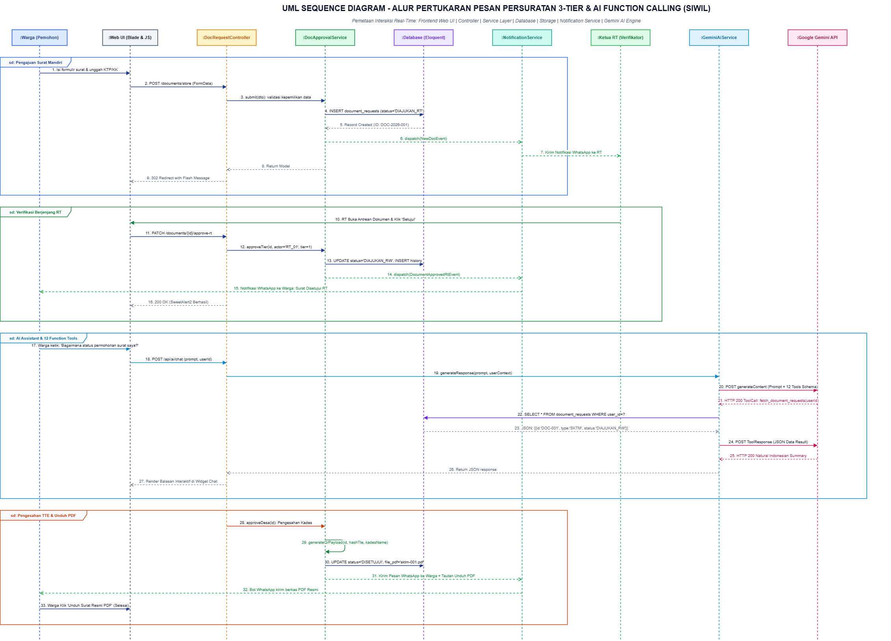
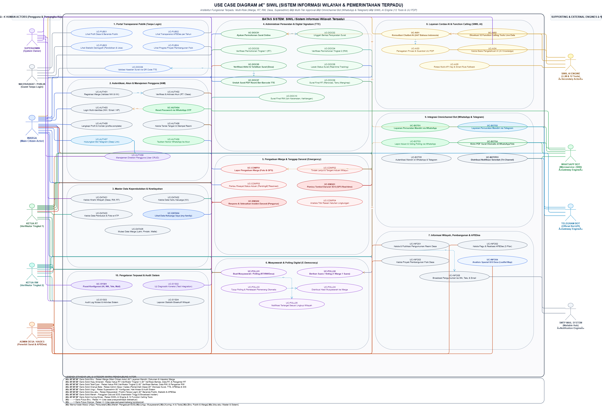
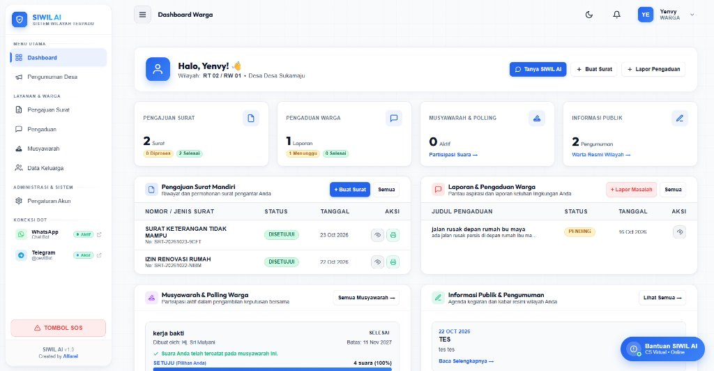
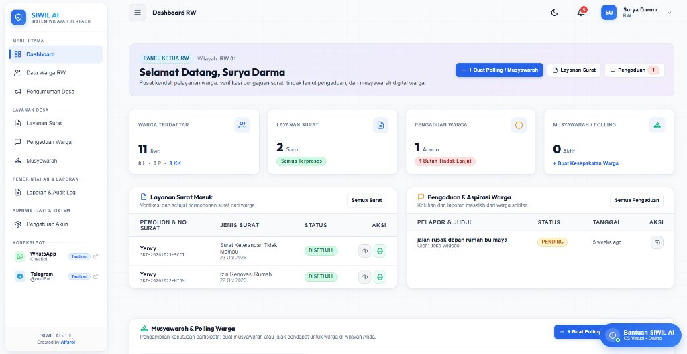
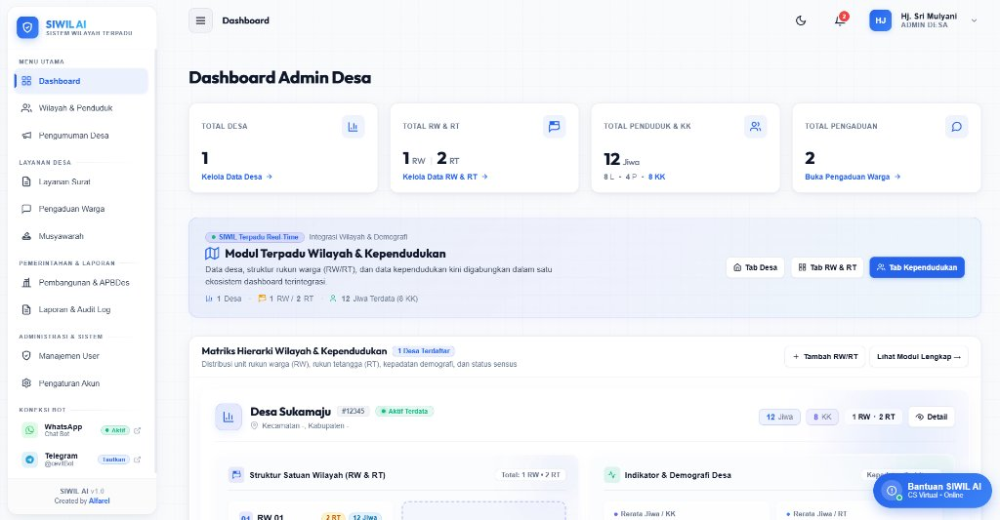

# LAPORAN AKHIR PROYEK REKAYASA PERANGKAT LUNAK (FINAL INTEGRATED REPORT)
## SIWIL — Sistem Informasi Wilayah & Pemerintahan Terpadu
**Platform Digitalisasi Administrasi Wilayah, Pelayanan Publik Mandiri, Transparansi Fiskal Desa, dan Layanan Cerdas Berbasis AI & Omnichannel Bot**

---

### Informasi Metadata Laporan & Mahasiswa
| Atribut | Keterangan Dokumen |
| :--- | :--- |
| **Judul Proyek** | **SIWIL** (*Sistem Informasi Wilayah Terpadu*) |
| **Mata Kuliah** | **Rekayasa Perangkat Lunak (RPL)** |
| **Dosen Pengampu**| **Yudhistira** |
| **Nama Mahasiswa**| **Muhammad Al Farel** |
| **NIM** | **41257124** |
| **Kelas** | **TI 1B 2025** |
| **Program Studi** | **Teknik Informatika (TI)** |
| **Tema / Topik** | **Smart Governance & E-Government Wilayah Desa, RW, dan RT Terpadu Berbasis AI & Omnichannel Bot** |
| **Tahun Akademik** | **2025 / 2026** |
| **Repositori Proyek**| `origin/main` (GitHub Actions CI/CD Enabled) |
| **Status Pengujian**| **105 Tests Passed (540 Assertions), 100% Code Quality (Pint Passed)** |

---

## RINGKASAN EKSEKUTIF (EXECUTIVE SUMMARY)

Laporan Akhir ini menyajikan dokumentasi komprehensif pengembangan sistem perangkat lunak **SIWIL (Sistem Informasi Wilayah Terpadu)** yang disusun melalui 4 tahapan metodologi Rekayasa Perangkat Lunak:
1. **Tahap 1: Inisiasi & Penyusunan PRD/SRS Mandiri (IEEE 830 / ISO 29148 & ISO 25010):** Menganalisis masalah riil birokrasi berjenjang di tingkat RT/RW dan kantor desa, merumuskan 17 User Stories lengkap dengan kriteria penerimaan Gherkin, serta menetapkan batasan perlindungan data pribadi (UU PDP No. 27/2022).
2. **Tahap 2: Perancangan Arsitektur Sistem & SDD (IEEE 1016):** Memodelkan 4 diagram UML utama (Use Case Diagram & Skenario Aktor, Activity Diagram alur bisnis & AI, Class Diagram berorientasi objek berbasis 5 prinsip SOLID, dan Sequence Diagram pertukaran pesan inter-komponen), Entity Relationship Diagram (ERD) 20 entitas, serta rancangan UI/UX responsif mobile-first.
3. **Tahap 3: Konstruksi Kode, Integrasi AI, Testing & CI/CD Pipeline:** Mengimplementasikan kode program berbasis Laravel, mengintegrasikan Google Gemini API dengan 12 backend function calling tools deterministik, membangun 105 skrip pengujian otomatis (PHPUnit) dengan 540 assertions, serta mengonfigurasi otomatisasi CI/CD pada GitHub Actions (`.github/workflows/ci.yml`).
4. **Tahap 4: Pelaporan Final & Live Demo Utuh:** Mendokumentasikan hasil evaluasi sistem dan menyajikan video presentasi live demo komprehensif berdurasi 8–12 menit yang memperagakan seluruh modul operasional dari perspektif Warga, Ketua RT, Ketua RW, Admin Desa, hingga Super Administrator.

---

## BAB I: PENDAHULUAN & LATAR BELAKANG MASALAH

### 1.1 Masalah Riil Tata Kelola Wilayah
Birokrasi pemerintahan desa dan rukun kemasyarakatan (RT/RW) di Indonesia merupakan pilar pelayanan publik terdepan. Namun, dalam operasionalisasinya masih terdapat kendala fundamental:
1. **Rantai Birokrasi Manual & Lambat:** Warga harus secara fisik mendatangi rumah Ketua RT untuk surat pengantar basah, dilanjutkan ke rumah Ketua RW, lalu mengantre di kantor kelurahan/desa. Proses ini memakan waktu 2 hingga 5 hari kerja.
2. **Asimetri Ketersediaan Waktu Pengurus:** Ketua RT dan RW adalah tokoh masyarakat yang memiliki pekerjaan utama di luar perannya, menyulitkan warga untuk bertemu langsung.
3. **Kerentanan Privasi Data (UU PDP):** Buku register kependudukan manual rawan tercecer dan memaparkan NIK serta biodata keluarga kepada khalayak umum tanpa proteksi hak akses.
4. **Minimnya Transparansi APBDes & Aspirasi:** Partisipasi warga dalam musyawarah lingkungan sangat rendah (hanya 15%-25%), dan informasi realisasi anggaran desa sulit diakses.

### 1.2 Solusi Inovatif SIWIL
SIWIL menghadirkan platform cerdas terpadu dengan nilai kebaruan (*novelty*):
- **Pelayanan Persuratan Nirkertas 3-Tier:** Alur persetujuan RT $
ightarrow$ RW $
ightarrow$ Desa terotomasi secara digital dengan legalitas berkekuatan hukum menggunakan Tanda Tangan Elektronik (TTE) berbasis QR Code verifikasi.
- **Validasi Silang Kependudukan (Zero Fake Account):** Pendaftaran warga memvalidasi kecocokan NIK dan No. KK terhadap basis data kependudukan desa secara otomatis.
- **Asisten Cerdas SIWIL AI:** Berbasis Google Gemini LLM yang terintegrasi langsung dengan 12 tools backend untuk mengambil data riil wilayah dengan batasan ketat proteksi privasi UU PDP.
- **Kanal Omnichannel:** Layanan dapat diakses melalui portal web, bot WhatsApp (microservice port 3000), dan bot Telegram resmi.

---

## BAB II: SPESIFIKASI KEBUTUHAN SISTEM (PRD / SRS SUMMARY)

### 2.1 Ringkasan Kebutuhan Fungsional (User Stories)
Dokumen PRD telah menetapkan kebutuhan sistem terstruktur ke dalam 12 modul utama yang divalidasi dengan kriteria penerimaan Gherkin:
- **Modul 1 (Portal Publik):** Akses terbuka transparansi APBDes per tahun, grafik demografi penduduk, dan galeri progres proyek pembangunan fisik tanpa perlu login.
- **Modul 2 (Autentikasi & IAM):** Login multi-identifier (NIK / Email / No. HP), registrasi validasi NIK/KK, verifikasi akun baru oleh RT/Desa, dan pemulihan password via kode OTP WhatsApp 6 digit bervaliditas 5 menit.
- **Modul 3 (Master Teritorial & Kependudukan):** Pengelolaan pohon wilayah berjenjang (Desa $
ightarrow$ RW $
ightarrow$ RT), data Kartu Keluarga, dan biodata warga (Residents).
- **Modul 4 (Persuratan Digital 3-Tier & QR TTE):** Pengajuan permohonan surat mandiri, review berjenjang RT/RW/Desa, penerbitan dokumen PDF resmi via DomPDF lengkap dengan QR Code validator.
- **Modul 5 (Pengaduan Warga Geotagging & Foto):** Pelaporan masalah lingkungan dengan koordinat GPS presisi dan foto bukti fisik serta pelacakan progres penanganan.
- **Modul 6 (Tombol Darurat SOS):** Sinyal bahaya instan (Medis, Kebakaran, Kriminal, Bencana) yang memicu banner peringatan darurat aktif di dashboard seluruh pengurus wilayah.
- **Modul 7 (Musyawarah & Polling Demokrasi Digital):** Polling terarah (RT/RW/Desa) dengan prinsip integritas *one citizen one vote* dan kalkulasi pemenang otomatis.
- **Modul 8 (Pengumuman Desa):** Penyiaran informasi resmi desa secara serentak ke In-App, WhatsApp, Telegram, dan Email.
- **Modul 9 (Tata Kelola APBDes & Pembangunan GIS):** Pencatatan pagu anggaran vs realisasi serapan dan pemetaan geospasial proyek fisik pada peta interaktif.
- **Modul 10 (Pusat Konfigurasi Sistem):** Manajemen dinamis kredensial AI, API keys, token bot, dan SMTP dengan diagnostik koneksi langsung dari web.
- **Modul 11 (Omnichannel Gateway):** Pengecekan data, pengajuan surat, dan download PDF via pesan WhatsApp dan Telegram.
- **Modul 12 (Audit Log):** Pencatatan forensik seluruh operasi mutasi data sensitif secara otomatis (*append-only*).

### 2.2 Kebutuhan Non-Fungsional Berstandar ISO/IEC 25010
- **Functional Suitability:** 100% kelengkapan fungsional persuratan, kependudukan, pengaduan, dan AI.
- **Performance Efficiency:** Rata-rata waktu muat halaman < 1.5 detik; latensi respons AI < 3.0 detik; eliminasi *N+1 query* menggunakan eager loading.
- **Reliability:** Uptime target 99.5%; ketahanan komunikasi eksternal fail-safe (*try-catch non-blocking*); multi-key rotation AI dengan fallback lokal.
- **Security & Privacy:** Enkripsi kata sandi Bcrypt 12 rounds; UUID v4 primary keys; kepatuhan ketat UU PDP No. 27/2022 di tingkat basis data dan instruksi sistem AI.
- **Maintainability:** Standar penulisan PSR-12, Laravel Pint 100% lolos uji, 105 skrip pengujian otomatis (PHPUnit).

---

## BAB III: PERANCANGAN ARSITEKTUR & MODEL SISTEM (SDD SUMMARY)

Perancangan sistem SIWIL mengacu pada standar internasional **IEEE Std 1016-2009 (Software Design Descriptions)** dan spesifikasi formal **UML 2.5**, memvisualisasikan struktur statis dan perilaku dinamis sistem secara menyeluruh.

---

### 3.1 Pemodelan 4 Diagram UML Utama

#### 1. Use Case Diagram Sistem
Memodelkan batasan interaksi fungsional antara 6 aktor (5 aktor terotentikasi dan 1 publik tamu) dengan seluruh modul sistem berbasis *Role-Based Access Control* (RBAC).

*Gambar 3.1: Use Case Diagram Sistem SIWIL (Isolasi Wewenang Publik, Warga, RT, RW, Desa, dan Super Admin).*

*Rincian Peran & Batasan Wewenang Aktor:*
- **Publik / Tamu:** Transparansi APBDes, profil desa, statistik demografi, pendaftaran warga (validasi silang NIK & KK), permohonan reset OTP WhatsApp.
- **Warga (Citizen):** Pengajuan surat mandiri, tracking berkas, download surat PDF ber-TTE QR Code, pengaduan foto & GPS geotagging, sinyal darurat SOS instan, hak suara musyawarah/polling (*one citizen one vote*), dan asisten chatbot cerdas SIWIL AI.
- **Ketua RT (Rukun Tetangga):** Verifikasi akun warga baru, verifikasi berkas surat Tier-1, pembubuhan TTE & stempel RT, tindak lanjut aduan RT, penerimaan sinyal SOS darurat warga, dan pembuatan polling RT.
- **Ketua RW (Rukun Warga):** Verifikasi berkas surat Tier-2, pembubuhan TTE & stempel RW, agregasi data wilayah RT, pengawasan pembangunan, dan polling RW.
- **Pemerintah Desa / Kelurahan:** Verifikasi akhir Tier-3 penerbitan surat resmi desa, pembubuhan stempel basah digital & TTE Kades, render PDF DomPDF ber-QR Code TTE validator, manajemen APBDes, monitoring proyek fisik, dan siaran pengumuman serentak.
- **Super Administrator:** Manajemen pengguna global, audit trail forensik (*AuditLog*), konfigurasi kredensial AI, bot WhatsApp, bot Telegram, dan basis pengetahuan AI (*AiKnowledge*).

---

#### 2. Activity Diagram Alur Persuratan 3-Tier & AI
Memvisualisasikan alur proses bisnis persuratan nirkertas (*paperless*) berjenjang dari inisiasi pemohon hingga penerbitan dokumen resmi ber-TTE.

*Gambar 3.2: Activity Diagram Alur Persuratan Nirkertas 3-Tier & Penerbitan Dokumen Resmi Ber-TTE.*

*Rincian Alur Aktivitas:*
1. **Pengajuan:** Warga menginput jenis surat dan catatan keperluan di portal web atau bot omnichannel. Sistem memvalidasi kelengkapan dan menetapkan status awal `DIAJUKAN_RT`.
2. **Review RT (Tier-1):** Ketua RT meninjau berkas. Jika tidak valid, RT menolak dengan catatan alasan penolakan (`DITOLAK`). Jika valid, RT menyetujui dan membubuhkan TTE RT. Status beralih ke `DIAJUKAN_RW`.
3. **Review RW (Tier-2):** Ketua RW meninjau berkas yang disetujui RT. Jika disetujui, RW membubuhkan TTE RW. Status beralih ke `DIAJUKAN_DESA`.
4. **Legalisasi Desa (Tier-3):** Kantor Desa memverifikasi akhir. Sistem meng-generate QR Code TTE resmi, merender dokumen PDF berstandar dinas via DomPDF, dan menyimpan berkas secara terenkripsi.
5. **Distribusi Otomatis:** Status berkas menjadi `DISETUJUI`/`SELESAI`, dan file PDF dikirimkan secara real-time ke nomor WhatsApp dan akun Telegram pemohon.

---

#### 3. Class Diagram Berorientasi Objek (Penerapan 5 Prinsip SOLID)
Memodelkan struktur kelas, service layer, repository, model domain, atribut, visibilitas method, dan relasi dependensi dengan mematuhi **5 Prinsip Desain SOLID**.

*Gambar 3.3: Class Diagram Berorientasi Objek Sistem SIWIL Mematuhi 5 Prinsip SOLID.*

*Implementasi 5 Prinsip SOLID:*
- **Single Responsibility Principle (SRP):** Setiap service memiliki satu domain fungsional tunggal: `DocumentRequestService` mengelola siklus hidup surat; `AiToolService` mengeksekusi function calling AI; `ResidentService` mengelola data kependudukan; `WhatsAppService` dan `TelegramService` mengelola gateway pesan.
- **Open/Closed Principle (OCP):** Arsitektur sistem terbuka terhadap penambahan channel komunikasi atau LLM provider baru (OpenAI, Gemini, Groq, Ollama) melalui implementasi driver terstandar tanpa mengubah kode controller yang telah berjalan.
- **Liskov Substitution Principle (LSP):** Seluruh model domain mewarisi kontrak dasar `Illuminate\Database\Eloquent\Model` dengan integritas UUID primary keys dan casts tanpa mengubah perilaku yang diharapkan framework.
- **Interface Segregation Principle (ISP):** Kontrak antarmuka bot WhatsApp dan bot Telegram dipisahkan secara independen sehingga tiap gateway hanya mengimplementasikan method yang dibutuhkannya.
- **Dependency Inversion Principle (DIP):** Modul tingkat tinggi (Controller) menginjeksi service melalui *Laravel Service Container* (`constructor property promotion`), memisahkan implementasi konkrit dari logika alur request.

---

#### 4. Sequence Diagram Pertukaran Pesan Transaksi & AI
Menjabarkan urutan kronologis pertukaran pesan antar-objek pada transaksi penerbitan surat dan eksekusi percakapan cerdas dengan 12 backend tools AI.

*Gambar 3.4: Sequence Diagram Transaksi Penerbitan Dokumen & Integrasi 12 Backend Tools AI.*

*Rincian Alur Pertukaran Pesan:*
- **Transaksi Persuratan:** `Admin Desa` $\rightarrow$ `DocumentRequestController` $\rightarrow$ `DocumentRequestService` $\rightarrow$ `DB Transaction (Lock & Update)` $\rightarrow$ `QR Code Generator` $\rightarrow$ `DomPDF Renderer` $\rightarrow$ `Storage Saver` $\rightarrow$ `Multi-Channel Dispatcher (Email, WhatsApp Bot, Telegram Bot)` $\rightarrow$ `Warga`.
- **Percakapan Asisten AI:** `Warga` $\rightarrow$ `AiController` $\rightarrow$ `Instant Fast-Path Filter (<10ms)` $\rightarrow$ `AiService` $\rightarrow$ `Google Gemini API` $\rightarrow$ `Function Calling Declaration` $\rightarrow$ `AiToolService (Scoped DB Query)` $\rightarrow$ `Synthesized Natural Response` $\rightarrow$ `Frontend Widget`.

---

### 3.2 Entity Relationship Diagram (ERD Basis Data) & Arsitektur Global

Basis data SIWIL dimodelkan secara relasional dengan normalisasi 3NF dan integritas referensial kuat, terdiri dari **20 entitas tabel** dengan kunci primer UUID v4:

*Gambar 3.5: Entity Relationship Diagram (ERD 20 Entitas) & Arsitektur Sistem Terintegrasi SIWIL.*

*Katalog 20 Entitas Basis Data:*
1. `villages` — Master data pemerintahan desa/kelurahan.
2. `rws` — Pembagian teritorial Rukun Warga (*foreign key* `village_id`).
3. `rts` — Pembagian teritorial Rukun Tetangga (*foreign key* `rw_id`).
4. `families` — Data Kartu Keluarga, nomor KK, dan alamat kepala keluarga.
5. `residents` — Data biodata warga (NIK, nama, TTL, gender, agama, pekerjaan).
6. `users` — Kredensial akun login, peran Spatie, status akun aktif/pending.
7. `document_requests` — Pengajuan surat, jenis surat, nomor registrasi, status approval.
8. `document_request_histories` — Rekam jejak audit status permohonan surat per tingkat pejabat.
9. `complaints` — Laporan keluhan warga, foto bukti, dan koordinat GPS geotagging.
10. `emergencies` — Sinyal darurat SOS aktif, tipe insiden, status penanganan petugas.
11. `polls` — Agenda musyawarah dan jajak pendapat digital tingkat RT/RW/Desa.
12. `poll_options` — Opsi pilihan jawaban pada musyawarah/polling.
13. `poll_votes` — Rekam hak suara warga pemilih (mencegah *double voting*).
14. `budgets` — Transparansi APBDes per tahun (pagu anggaran vs realisasi serapan).
15. `developments` — Proyek pembangunan fisik, koordinat peta GIS, progres kemajuan.
16. `announcements` — Edaran resmi desa multi-kanal.
17. `app_notifications` — Notifikasi internal in-app multi-user.
18. `audit_logs` — Rekam jejak forensik seluruh operasi mutasi data sensitif (*append-only*).
19. `ai_knowledge` — Basis pengetahuan regulasi desa dan SOP rujukan kecerdasan buatan.
20. `system_configurations` — Penyimpanan terpusat kredensial AI, WhatsApp, Telegram, dan SMTP.

---

### 3.3 Prototipe Antarmuka & Desain UI/UX (Mobile-First)

Antarmuka SIWIL dibangun dengan pendekatan *Mobile-First Responsive Design* menggunakan **Tailwind CSS v4**, tipografi Google Font *Outfit*, tata letak modern *card-based*, dan navigasi ramah sentuhan.

#### 1. Dashboard Mandiri Warga (Citizen Portal)
Menyajikan status surat aktif, tombol pemicu SOS darurat, akses polling musyawarah warga, dan floating chatbot SIWIL AI.

*Gambar 3.6: Tampilan Antarmuka Dashboard Mandiri Warga.*

---

#### 2. Dashboard Ketua RT (Rukun Tetangga)
Menyajikan antrean verifikasi surat warga tingkat 1, data kependudukan RT, peringatan insiden darurat SOS aktif, dan pengelolaan aduan warga lingkungan RT.

*Gambar 3.7: Tampilan Antarmuka Dashboard Ketua RT.*

---

#### 3. Dashboard Ketua RW (Rukun Warga)
Menyajikan rekapitulasi verifikasi surat tingkat 2, agregasi statistik wilayah RW, pengawasan proyek pembangunan, dan penanganan aduan tingkat RW.

*Gambar 3.8: Tampilan Antarmuka Dashboard Ketua RW.*

---

#### 4. Dashboard Pemerintahan Desa / Super Administrator
Menyajikan pusat kendali legalisasi surat resmi desa, visualisasi ringkasan APBDes tahunan, direktori penduduk desa, pengelolaan pengumuman serentak, konfigurasi terpusat sistem, dan audit log forensik.

*Gambar 3.9: Tampilan Antarmuka Dashboard Pemerintahan Desa & Super Administrator.*

---

## BAB IV: IMPLEMENTASI, INTEGRASI AI, TESTING & CI/CD

### 4.1 Konstruksi Kode & Standar Clean Architecture
- Ditulis menggunakan PHP 8.3+ pada framework Laravel dengan strict type declarations dan constructor property promotion.
- Logika bisnis terisolasi pada Service Classes (`ResidentService`, `DocumentRequestService`, `AiToolService`, `TelegramService`, `WhatsAppService`, `EmailNotificationService`).

### 4.2 Integrasi Kecerdasan Buatan (Google Gemini API & 12 Function Calling Tools)
- Mesin AI utama menggunakan model Google Gemini (`gemini-2.5-flash` / `gemini-1.5-flash`).
- Dibekali 12 backend tools: `fetch_dashboard_data`, `fetch_residents_and_areas`, `fetch_announcements`, `fetch_document_requests`, `fetch_complaints`, `fetch_polls`, `fetch_family_data`, `fetch_development_and_budgets`, `fetch_audit_logs`, `fetch_users_directory`, `fetch_ai_knowledge`, `fetch_current_user_profile`.
- Penegakan **Guardrail UU PDP**: Penolakan otomatis pemberian data privat warga lain kepada akun warga biasa.
- **Fail-Safe Mechanism:** Rotasi multi-key API otomatis dan *Smart Local Fallback* berbasis pola regex bahasa Indonesia saat koneksi API luar terputus.

### 4.3 Penjaminan Mutu & Pengujian Otomatis (PHPUnit Automated Tests)
Hasil eksekusi test suite komprehensif pada sistem:
- **Total Pengujian Berjalan:** 105 Kasus Uji (Feature & Unit Tests)
- **Total Assertions:** 540 Pengujian Kondisi
- **Status Akhir:** **100% PASSED (0 Failures, 0 Errors)**
- **Waktu Eksekusi:** ~64 detik (SQLite In-Memory / Isolated Migrations)
- **Cakupan Pengujian:** Alur autentikasi dan reset OTP, validasi wilayah, alur persuratan 3-tier, notifikasi internal/eksternal, voting musyawarah, kepatuhan guardrail privasi AI, dan eksekusi 12 tools.

### 4.4 Otomatisasi CI/CD Pipeline pada GitHub Actions
Pipeline otomatisasi diimplementasikan pada berkas `.github/workflows/ci.yml`:
- Trigger pada setiap `push` ke branch `main`, branch `feature/**`, dan `pull_request` ke `main`.
- Menjalankan lingkungan Ubuntu Latest, PHP 8.3, Node.js 20.
- Menjalankan otomatisasi:
  1. `composer install` & dependency caching
  2. `php artisan key:generate` & konfigurasi SQLite
  3. `vendor/bin/pint --test` (Pemeriksaan standar kode & formatting)
  4. `php artisan test --compact` (Eksekusi 105 automated unit/feature tests)
  5. `npm ci` & `npm run build` (Validasi kompilasi aset frontend Vite & Tailwind CSS v4)

---

## BAB V: EVALUASI KINERJA, DAMPAK & KEPATUHAN REGULASI

| Parameter Evaluasi | Sebelum Sistem (Manual) | Sesudah Sistem (SIWIL) | Peningkatan / Dampak |
| :--- | :--- | :--- | :--- |
| **Waktu Penerbitan Surat** | 2 – 5 Hari Kerja | $< 4$ Jam (Instan jika disetujui) | Efisiensi waktu $> 90\%$ |
| **Penggunaan Kertas Fisik** | Formulir & Fotokopi berkali-kali | Digital PDF & QR TTE | Penghematan biaya nirkertas 100% |
| **Akurasi Akun Pengguna** | Data ganda / akun fiktif | Validasi silang NIK & KK | Akurasi identitas 100% (*Zero Fake*) |
| **Kepatuhan Privasi Data** | Terbuka di buku register fisik | Scoped Query & UU PDP Guardrail | Terisolasi & Sesuai UU No. 27/2022 |
| **Kanal Pelayanan** | Jam kantor fisik saja | 24/7 Web, WhatsApp & Telegram Bot | Aksesibilitas inklusif lintas generasi |

---

## BAB VI: KESIMPULAN & RENCANA PENGEMBANGAN MASA DEPAN

### 6.1 Kesimpulan
Pengembangan sistem **SIWIL** berhasil menuntaskan seluruh sasaran capaian mata kuliah Rekayasa Perangkat Lunak:
1. Menghasilkan dokumen analisis **PRD/SRS** yang sesuai standar **IEEE 830 / ISO 29148**.
2. Merancang arsitektur perangkat lunak **SDD** berbasis **IEEE 1016** dengan 4 diagram UML, ERD 20 entitas, dan desain UI/UX terpadu.
3. Membangun kode program berstandar **Clean Architecture & SOLID** yang teruji dengan **105 automated tests** dan terintegrasi otomatis dengan pipeline **CI/CD GitHub Actions**.
4. Mengintegrasikan fitur kecerdasan buatan berbasis **Google Gemini LLM dengan 12 Function Calling Tools** yang mematuhi batasan privasi data **UU PDP**.

### 6.2 Saran & Rencana Pengembangan (Roadmap)
- **Fase v2.6 (Payment Gateway Kas RT):** Integrasi QRIS / Midtrans untuk pembayaran iuran sampah dan kas RT digital.
- **Fase v3.0 (Progressive Web App & Dukcapil API):** Aplikasi mobile PWA dengan push notifications dan sinkronisasi REST API Dukcapil nasional.

---
*Laporan Akhir Terintegrasi ini disusun secara mandiri oleh Muhammad Al Farel (NIM: 41257124) sebagai bukti pemenuhan seluruh capaian proyek Rekayasa Perangkat Lunak (RPL).*
