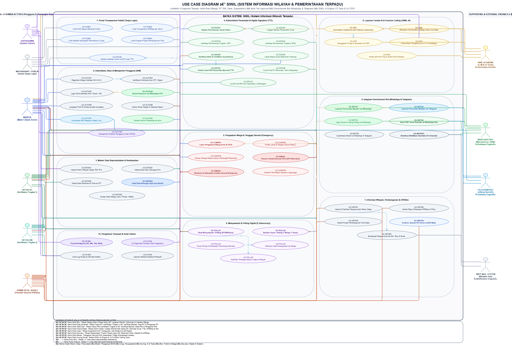
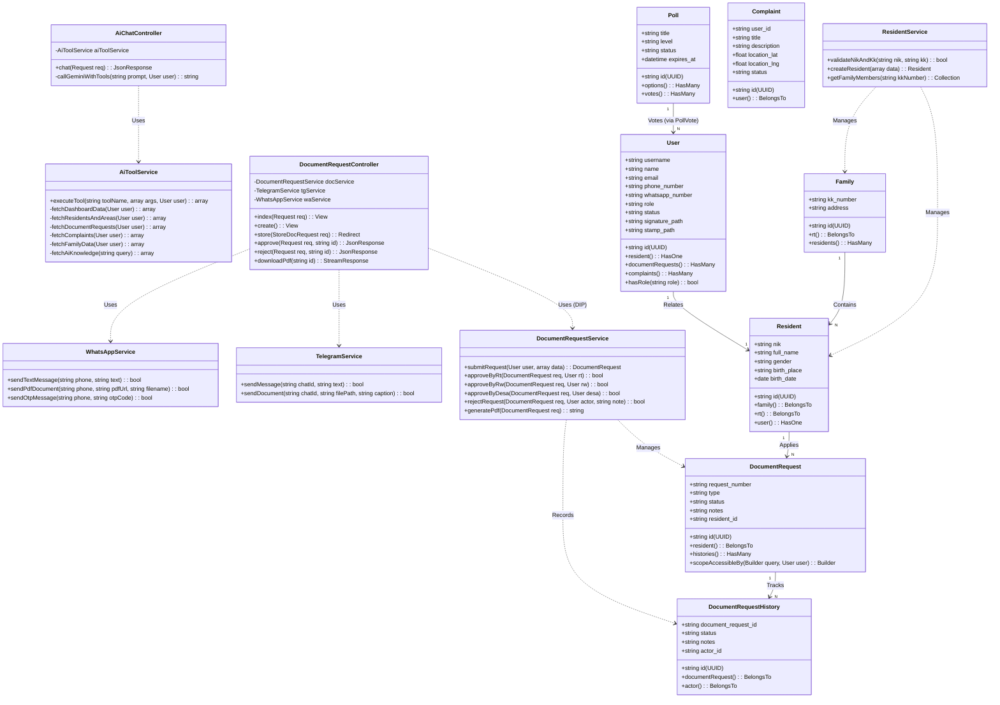
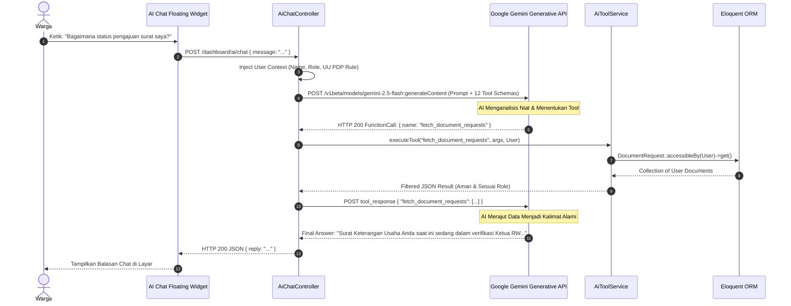
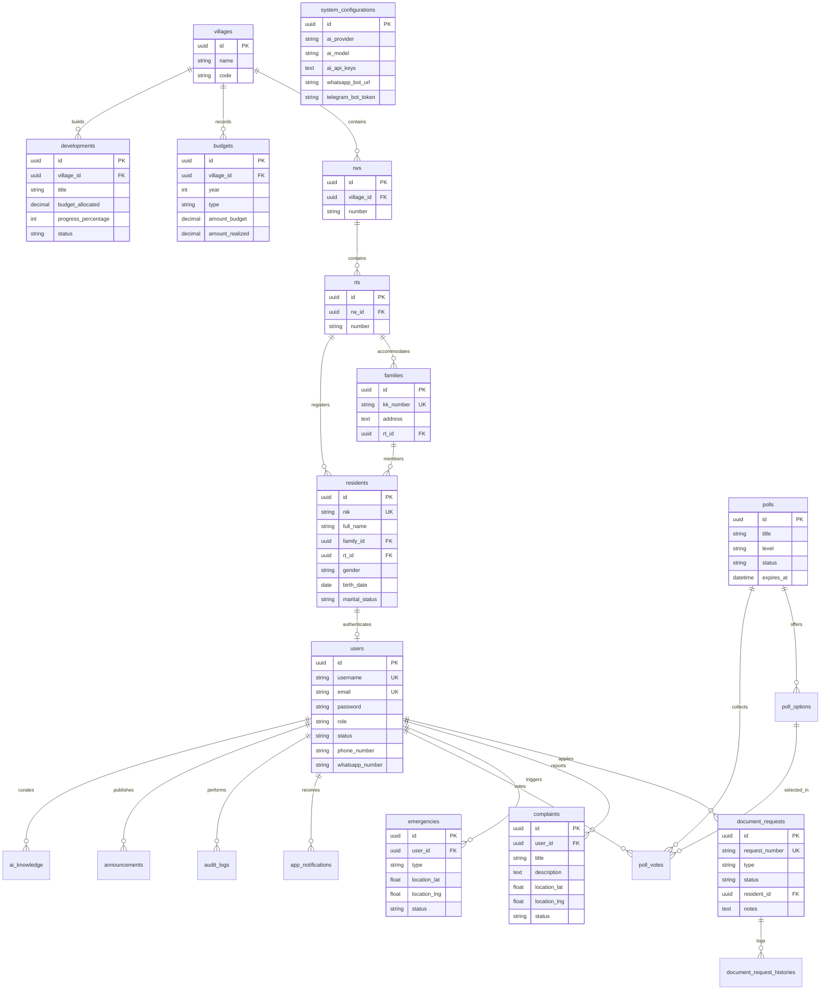

# DOKUMEN PERANCANGAN PERANGKAT LUNAK (SOFTWARE DESIGN DESCRIPTION - SDD)
## SIWIL — Sistem Informasi Wilayah & Pemerintahan Terpadu
**Standar Acuan: IEEE Std 1016-2009 (Standard for Information Technology — Systems Design — Software Design Descriptions)**

---

### Informasi Metadata Dokumen & Pengembang
| Atribut | Keterangan Dokumen |
| :--- | :--- |
| **Judul Produk** | **SIWIL** (*Sistem Informasi Wilayah Terpadu*) |
| **Mata Kuliah** | **Rekayasa Perangkat Lunak (RPL)** |
| **Dosen Pengampu**| **Yudhistira** |
| **Nama Pengembang**| **Muhammad Al Farel** |
| **NIM** | **41257124** |
| **Kelas** | **TI 1B 2025** |
| **Program Studi** | **Teknik Informatika** |
| **Tema / Topik** | **Smart Governance & E-Government Wilayah Desa, RW, dan RT Berbasis AI & Omnichannel Bot** |
| **Versi Dokumen** | **v2.5.0 (Final Architecture & Design - As-Built)** |
| **Status Dokumen** | **Disetujui untuk Konstruksi & Evaluasi Akademik** |
| **Tanggal Terbit** | **Maret 2026** |

---

## DAFTAR ISI
1. [BAB I: PENDAHULUAN & ARSITEKTUR UMUM SISTEM](#bab-i-pendahuluan--arsitektur-umum-sistem)
   - 1.1 Tujuan Dokumen SDD
   - 1.2 Ruang Lingkup Perancangan
   - 1.3 Arsitektur Tingkat Tinggi (High-Level Layered Architecture)
   - 1.4 Penerapan Pola Desain (Design Patterns)
2. [BAB II: PEMODELAN 4 DIAGRAM UML UTAMA](#bab-ii-pemodelan-4-diagram-uml-utama)
   - 2.1 Use Case Diagram & Skenario Use Case Lengkap
   - 2.2 Activity Diagram (Alur Bisnis & AI)
   - 2.3 Class Diagram Berorientasi Objek & Kepatuhan Prinsip SOLID
   - 2.4 Sequence Diagram (Alur Pertukaran Pesan Real-Time)
3. [BAB III: PERANCANGAN BASIS DATA & ENTITY RELATIONSHIP DIAGRAM (ERD)](#bab-iii-perancangan-basis-data--entity-relationship-diagram-erd)
   - 3.1 Konsep Struktur Data (UUID Primary Key & Multi-Tenancy Scoping)
   - 3.2 Diagram Hubungan Entitas (ERD 20 Tabel Model)
   - 3.3 Kamus Data & Spesifikasi Kolom Utama
4. [BAB IV: PERANCANGAN ANTARMUKA PENGGUNA (UI/UX DESIGN & FIGMA PROTOTYPE)](#bab-iv-perancangan-antarmuka-pengguna-uiux-design--figma-prototype)
   - 4.1 Design System Tokens (Color Palette, Typography, Elevations)
   - 4.2 Arsitektur Tata Letak (Layouts & Navigation Structure)
   - 4.3 Spesifikasi Wireframe & Alur Layar Interaktif (Mockup Flows)
5. [BAB V: KESIMPULAN & PENYELARASAN MENUJU TAHAP KONSTRUKSI](#bab-v-kesimpulan--penyelarasan-menuju-tahap-konstruksi)

---

## BAB I: PENDAHULUAN & ARSITEKTUR UMUM SISTEM

### 1.1 Tujuan Dokumen SDD
Dokumen **Software Design Description (SDD)** ini menyajikan visualisasi terstruktur, spesifikasi perilaku objek, pemodelan data, dan arsitektur teknis dari sistem perangkat lunak **SIWIL**. Dokumen ini menerjemahkan kebutuhan fungsional dan non-fungsional dari PRD/SRS ke dalam cetak biru (*blueprint*) teknis yang mematuhi standar rekayasa perangkat lunak berorientasi objek (**OOP**) dan prinsip desain **SOLID**.

### 1.2 Ruang Lingkup Perancangan
Perancangan mencakup:
1. Pemodelan sistem menggunakan 4 diagram UML utama: **Use Case Diagram** beserta skenario formal, **Activity Diagram** alur bisnis & AI, **Class Diagram** terstruktur SOLID, dan **Sequence Diagram** alur pesan inter-komponen.
2. Perancangan basis data relasional (**ERD**) mencakup 20 entitas dengan *primary key* UUID v4.
3. Spesifikasi desain antarmuka pengguna (**UI/UX**) dan tata letak *mobile-first* yang siap diimplementasikan pada prototipe Figma dan aplikasi web nyata.

### 1.3 Arsitektur Tingkat Tinggi (High-Level Layered Architecture)
SIWIL mengadopsi arsitektur berlapis (*Layered Architecture*) yang memisahkan tanggung jawab secara tegas (*Separation of Concerns*):

```
┌───────────────────────────────────────────────────────────────────────────────────┐
│                           PRESENTATION LAYER (VIEW)                               │
│  Blade Templates + Tailwind CSS v4 | Mobile Responsive UI | Floating AI Chat Widget│
└────────────────────────────────────────┬──────────────────────────────────────────┘
                                         │ HTTP Request / REST
                                         ▼
┌───────────────────────────────────────────────────────────────────────────────────┐
│                        CONTROLLER & ROUTING LAYER                                 │
│  - Web Middleware (auth, profile.complete, Spatie RoleMiddleware)                 │
│  - Web Controllers (DocumentRequestController, ComplaintController, etc.)         │
│  - External API Controllers (WhatsAppController, TelegramController, AiChatCtrl)   │
└────────────────────────────────────────┬──────────────────────────────────────────┘
                                         │ Business Delegation
                                         ▼
┌───────────────────────────────────────────────────────────────────────────────────┐
│                        SERVICE & DOMAIN LOGIC LAYER                               │
│  - DocumentRequestService (3-tier approval logic, QR code hash, PDF compilation)  │
│  - ResidentService (cross-validation NIK/KK, territorial cascading)              │
│  - AiToolService (12 deterministic function calling tools + UU PDP guardrails)    │
│  - TelegramService & WhatsAppService (Omnichannel message dispatchers)            │
│  - EmailNotificationService (SMTP queue mailables)                                │
└────────────────────────────────────────┬──────────────────────────────────────────┘
                                         │ Data Persistence & Query
                                         ▼
┌───────────────────────────────────────────────────────────────────────────────────┐
│                        DATA ACCESS & PERSISTENCE LAYER                            │
│  - Eloquent ORM (20 Models with HasUuids & Scoped Queries)                        │
│  - MySQL 8.0 / SQLite 3 Database Engines                                          │
│  - External Engines: Google Gemini Generative API, DomPDF Engine                  │
└───────────────────────────────────────────────────────────────────────────────────┘
```

### 1.4 Penerapan Pola Desain (Design Patterns)
1. **Repository / Service Pattern:** Menghindarkan penulisan logika bisnis gemuk di dalam Controller (*Fat Models, Thin Controllers* digantikan dengan *Lean Controllers, Specialized Services*).
2. **Strategy Pattern (AI Multi-Model Provider):** Pilihan AI engine (Gemini, OpenAI, Groq, Fallback) dienkapsulasi sehingga dapat saling dipertukarkan tanpa mengubah kode pemanggil.
3. **Observer / Event-Driven Pattern:** Mutasi status surat memicu *event* penyiaran notifikasi serentak ke saluran WhatsApp, Telegram, In-App, dan Email secara paralel.
4. **Singleton Pattern:** Konfigurasi dinamis sistem (`system_configurations`) di-cache dalam bentuk objek singleton untuk efisiensi kueri.

---

## BAB II: PEMODELAN 4 DIAGRAM UML UTAMA

### 2.1 Use Case Diagram & Skenario Use Case Lengkap

#### 2.1.1 Use Case Diagram Overview
Sistem memodelkan interaksi antara 5 aktor pengguna terotentikasi (**Warga**, **Ketua RT**, **Ketua RW**, **Admin Desa**, **Super Administrator**) dan 1 aktor **Publik (Tamu)**. Berkas diagram grafis lengkap dengan pembagian warna unik (*color-coded*) per aktor tersimpan pada file `diagram.drawio` dan `usecase_diagram.drawio`.



Berikut adalah matriks relasi aktor ke Use Case:
- **Warga (Biru `#1D4ED8`):** Registrasi Mandiri, Login Multi-Identifier, Ubah Profil & Tautkan Bot, Ajukan Permohonan Surat, Cek Status & Download PDF, Lapor Pengaduan Foto/GPS, Tekan Tombol Darurat SOS, Voting Musyawarah Polling, Konsultasi Asisten AI.
- **Ketua RT (Hijau `#15803D`):** Verifikasi Akun Warga Baru, Kelola Data Penduduk & KK RT, Verifikasi Surat Tingkat 1 (Approve/Reject), Respon Aduan Wilayah RT, Tangani Peringatan Darurat SOS, Buat Polling Tingkat RT.
- **Ketua RW (Teal `#0D9488`):** Verifikasi Surat Tingkat 2 (Approve/Reject), Monitor Demografi RW, Buat Polling Tingkat RW, Disposisi Aduan Lintas RT.
- **Admin Desa (Oranye `#C2410C`):** Verifikasi Akhir & Terbitkan Surat Resmi, Pengesahan TTE QR & Stempel Desa, Kelola Master Teritorial RW/RT, Kelola APBDes & Proyek Pembangunan Fisik, Publikasi Pengumuman Resmi Desa.
- **Super Administrator (Ungu `#6D28D9`):** Konfigurasi Global (AI Provider, Bot WA/Telegram, Mailer), Kelola Multi-Desa, Manajemen Seluruh User, Inspeksi Audit Trail Log.
- **Publik / Tamu (Abu-abu `#64748B`):** Akses Beranda Desa, Pantau APBDes Terbuka, Tinjau Statistik Kependudukan, Pantau Proyek Pembangunan.

---

#### 2.1.2 Skenario Use Case Formal (Use Case Specifications)

##### Skenario UC-01: Registrasi Warga Baru Berbasis Validasi Silang
- **Use Case ID:** UC-01
- **Nama Use Case:** Registrasi Akun Warga Mandiri
- **Aktor Utama:** Warga (Calon Pengguna)
- **Prekondisi:** Calon pengguna belum memiliki akun SIWIL, namun data kependudukannya (NIK dan No. KK) telah diinput sebelumnya oleh Ketua RT/Admin Desa ke dalam database kependudukan.
- **Postkondisi:** Akun pengguna terbuat di tabel `users` dengan status `pending` dan menunggu persetujuan verifikasi oleh Ketua RT atau Admin Desa.
- **Alur Utama (Main Flow):**
  1. Pengguna membuka halaman `/register`.
  2. Pengguna mengisi formulir: NIK (16 digit), Nomor Kartu Keluarga (16 digit), Nama Lengkap, Nomor WhatsApp, Email, dan Kata Sandi.
  3. Pengguna menekan tombol "Daftar Akun".
  4. Sistem memvalidasi keberadaan NIK pada tabel `residents` dan Nomor KK pada tabel `families`.
  5. Sistem memeriksa bahwa NIK tersebut belum pernah digunakan oleh akun lain.
  6. Sistem menyimpan rekaman baru pada tabel `users` dengan peran `WARGA` dan status `pending`.
  7. Sistem menampilkan pesan sukses dan instruksi menunggu verifikasi pengurus RT/Desa.
- **Alur Alternatif (Alternative Flow):**
  - *4a. NIK atau No. KK tidak ditemukan di basis data:* Sistem membatalkan pendaftaran dan menampilkan pesan: *"NIK atau Nomor KK tidak terdaftar dalam data kependudukan resmi desa. Silakan hubungi Ketua RT Anda."*
  - *5a. NIK sudah memiliki akun aktif:* Sistem menampilkan pesan: *"NIK ini sudah terdaftar. Silakan lakukan login atau gunakan fitur lupa kata sandi."*

---

##### Skenario UC-02: Pengajuan Permohonan Surat Mandiri
- **Use Case ID:** UC-02
- **Nama Use Case:** Pengajuan Permohonan Surat Digital
- **Aktor Utama:** Warga
- **Prekondisi:** Warga telah login dan profil kependudukannya telah lengkap (`profile.complete`).
- **Postkondisi:** Transaksi pengajuan surat tersimpan di tabel `document_requests` dengan status awal `DIAJUKAN_RT`, dan notifikasi terkirim ke Ketua RT.
- **Alur Utama (Main Flow):**
  1. Warga mengakses menu "Pengajuan Surat" (`/dashboard/documents/create`).
  2. Warga memilih jenis surat yang dibutuhkan (misal: SKTM, Surat Keterangan Domisili, Surat Keterangan Usaha).
  3. Warga mengisi form keterangan keperluan dan mengunggah berkas syarat (KTP/bukti pendukung).
  4. Warga menekan tombol "Kirim Permohonan".
  5. Sistem men-generate Nomor Registrasi Permohonan unik (format: `DOC-YYYYMMDD-XXXX`).
  6. Sistem menyimpan permohonan dengan status `DIAJUKAN_RT`.
  7. Sistem mencatat baris riwayat di tabel `document_request_histories`.
  8. Sistem mengirimkan notifikasi instan (In-App & WhatsApp) kepada Ketua RT di wilayah domisili pemohon.
- **Alur Alternatif:**
  - *3a. Berkas lampiran melebihi 2MB atau format tidak valid:* Sistem menampilkan validasi gagal dan meminta pengguna mengunggah berkas gambar/PDF di bawah 2MB.

---

##### Skenario UC-03: Verifikasi Berjenjang Surat (Approval 3-Tier) & Penerbitan TTE
- **Use Case ID:** UC-03
- **Nama Use Case:** Verifikasi Persuratan Berjenjang & Penerbitan Dokumen TTE
- **Aktor Utama:** Ketua RT, Ketua RW, Admin Desa
- **Prekondisi:** Berkas surat telah diajukan oleh warga dan berada pada status antrean verifikasi aktor terkait.
- **Postkondisi:** Surat disahkan dengan Tanda Tangan Elektronik ber-QR Code dan file PDF resmi ter-generate.
- **Alur Utama (Main Flow):**
  1. **Tahap RT:** Ketua RT membuka menu antrean surat, memeriksa biodata pemohon dan lampiran, lalu menekan tombol "Setujui". Status berubah menjadi `DIAJUKAN_RW`.
  2. **Tahap RW:** Ketua RW membuka antrean surat yang telah disetujui RT, memeriksa keabsahan, lalu menekan tombol "Setujui". Status berubah menjadi `DIAJUKAN_DESA`.
  3. **Tahap Desa:** Admin Desa memeriksa berkas akhir, membubuhkan stempel digital desa dan TTE Kepala Desa, lalu menekan tombol "Setujui & Terbitkan".
  4. Sistem mengubah status dokumen menjadi `DISETUJUI` / `SELESAI`.
  5. Sistem men-generate payload QR Code verifikasi (memuat URL publik `https://siwil.desa.id/verify-document/{id}`).
  6. Sistem mengompilasi berkas PDF menggunakan template DomPDF dengan tata letak resmi kop desa.
  7. Sistem mengirimkan berkas/tautan download PDF otomatis kepada warga via In-App, WhatsApp, dan Telegram.
- **Alur Alternatif (Penolakan Surat):**
  - *1a / 2a / 3a. Petugas menolak surat:* Petugas wajib mengisi catatan alasan penolakan (misal: "Lampiran PBB belum diunggah"). Status permohonan berubah menjadi `DITOLAK`. Warga menerima notifikasi alasan penolakan dan dapat mengajukan ulang.

---

##### Skenario UC-04: Pelaporan Aduan Warga Berbasis Geotagging & Foto Bukti
- **Use Case ID:** UC-04
- **Nama Use Case:** Pelaporan Pengaduan Fasilitas Lingkungan
- **Aktor Utama:** Warga
- **Prekondisi:** Warga telah login.
- **Postkondisi:** Rekaman pengaduan tersimpan di tabel `complaints` dengan titik koordinat GPS dan foto bukti fisik.
- **Alur Utama (Main Flow):**
  1. Warga membuka menu "/dashboard/complaints/create".
  2. Warga mengisikan judul keluhan, kategori masalah, dan uraian detail.
  3. Warga mengunggah foto kondisi fisik di lapangan.
  4. Peramban meminta izin akses lokasi; sistem membaca koordinat GPS perangkat (`latitude` dan `longitude`).
  5. Warga menekan tombol "Kirim Pengaduan".
  6. Sistem menyimpan rekaman aduan berstatus `PENDING` dengan relasi yurisdiksi RT dan RW pelapor.
  7. Sistem mengirimkan peringatan kepada Ketua RT dan RW setempat.
- **Alur Alternatif:**
  - *4a. Pengguna menolak izin GPS peramban:* Sistem meminta pengguna mengisi penanda lokasi teks secara manual (misal: "Depan pos kamling RT 02").

---

##### Skenario UC-05: Pemicu Tombol Tanggap Darurat (Emergency SOS)
- **Use Case ID:** UC-05
- **Nama Use Case:** Aktivasi Peringatan Darurat SOS
- **Aktor Utama:** Warga
- **Prekondisi:** Warga berada dalam situasi bahaya mendesak (Medis, Kebakaran, Kriminalitas, Bencana).
- **Postkondisi:** Data insiden darurat aktif tercatat di tabel `emergencies`, memicu peringatan darurat visual serentak di dashboard seluruh pengurus wilayah.
- **Alur Utama (Main Flow):**
  1. Warga menekan tombol merah mengambang "EMERGENCY SOS" di dashboard.
  2. Modal konfirmasi darurat muncul dengan 4 pilihan kategori: Medis, Kebakaran, Kriminal, Bencana Alam.
  3. Warga memilih kategori dan menekan "KIRIM SINYAL BAHAYA".
  4. Sistem menangkap koordinat GPS terkini dan menyimpan record status `ACTIVE` di tabel `emergencies`.
  5. Banner merah kedip peringatan darurat seketika muncul di dashboard Ketua RT, Ketua RW, dan Admin Desa.
  6. Pengurus wilayah menekan tombol "Lihat Titik Lokasi" yang membuka peta rute Google Maps / Leaflet menuju titik koordinat korban.
  7. Setelah pertolongan tiba, petugas menekan tombol "Tandai Selesai" (`RESOLVED`).

---

##### Skenario UC-06: Konsultasi Interaktif Cerdas SIWIL AI Assistant
- **Use Case ID:** UC-06
- **Nama Use Case:** Tanya Jawab Layanan & Data Wilayah via AI
- **Aktor Utama:** Warga, Pengurus Wilayah
- **Prekondisi:** Pengguna terotentikasi membuka widget chatbot AI.
- **Postkondisi:** AI memberikan jawaban cerdas, faktual, dan mematuhi batasan privasi UU PDP.
- **Alur Utama (Main Flow):**
  1. Pengguna mengetikkan pertanyaan pada widget chat (misal: *"Bagaimana status pengajuan surat saya?"* atau *"Berapa total warga di desa ini?"*).
  2. Sistem menyuntikkan identitas pengguna, peran, dan klausul guardrail UU PDP ke dalam *system instruction*.
  3. Backend mengirimkan prompt ke Google Gemini API beserta skema 12 backend tools.
  4. Model Gemini mengenali niat pengguna dan mengembalikan permintaan *function calling* (misal: memanggil `fetch_document_requests`).
  5. Backend mengeksekusi function tool secara aman dengan kueri terisolasi peran pengguna (`user_id = current_user`).
  6. Backend mengirimkan kembali hasil data JSON ke model Gemini.
  7. Model Gemini merangkum data menjadi kalimat Bahasa Indonesia yang ramah dan menampilkannya di layar percakapan pengguna.
- **Alur Alternatif (Pelanggaran Privasi UU PDP):**
  - *1a. Warga meminta nomor HP atau NIK warga lain:* Prompt guardrail mendeteksi pelanggaran privasi; AI secara tegas menolak dan memberikan edukasi bahwa data pribadi dilindungi undang-undang.
  - *3a. Kuota API Gemini habis (HTTP 429):* Sistem secara otomatis beralih ke API Key cadangan atau beralih ke mesin pencocokan pola lokal (*Smart Local Fallback*).

---

### 2.2 Activity Diagram (Alur Bisnis & AI)

#### 2.2.1 Alur Pelayanan Persuratan & Pengesahan TTE Digital
Diagram aktivitas persuratan memodelkan interaksi nirkertas berjenjang dari pemohon hingga penerbitan surat:

```
[ Warga ]                  [ Ketua RT ]               [ Ketua RW ]              [ Admin Desa ]
   │                            │                          │                          │
   ▼                            │                          │                          │
(Isi Form Surat)                │                          │                          │
   │                            │                          │                          │
   ▼                            │                          │                          │
(Upload Lampiran)               │                          │                          │
   │                            │                          │                          │
   ▼                            │                          │                          │
(Submit Permohonan) ───────────►│                          │                          │
                                ▼                          │                          │
                         <Verifikasi RT>                   │                          │
                           │         │                     │                          │
                   [Tolak] │         │ [Setuju]            │                          │
                           │         ▼                     │                          │
                           │  (Status DIAJUKAN_RW) ───────►│                          │
                           │                               ▼                          │
                           │                        <Verifikasi RW>                   │
                           │                          │         │                     │
                           │                  [Tolak] │         │ [Setuju]            │
                           │                          │         ▼                     │
                           │                          │  (Status DIAJUKAN_DESA) ─────►│
                           │                          │                               ▼
                           │                          │                        <Verifikasi Desa>
                           │                          │                          │         │
                           │                          │                  [Tolak] │         │ [Setuju]
                           ▼                          ▼                          ▼         ▼
                    (Status DITOLAK) ◄───────────────────────────────────────────┘    (Status DISETUJUI)
                           │                                                               │
                           ▼                                                               ▼
                    [Kirim Notifikasi]                                              (Generate QR Code TTE)
                                                                                           │
                                                                                           ▼
                                                                                    (Kompilasi DomPDF)
                                                                                           │
                                                                                           ▼
[ Warga Terima PDF Resmi Ber-Barcode ] ◄─────────────────────────────────────────────┘
```

#### 2.2.2 Alur Pemrosesan AI Function Calling & Privacy Guardrails
```
  [User Kirim Chat] 
         │
         ▼
[Injeksi System Context: Peran User + Teritorial + UU PDP Guardrail]
         │
         ▼
[Panggilan API Google Gemini LLM]
         │
         ▼
    <Deteksi Niat: Butuh Data Sistem?>
      ├── [TIDAK] ──► (Generasi Jawaban Teks Langsung) ──► [Kirim ke Chat Widget]
      └── [YA]    ──► (Model Memilih Salah Satu dari 12 Function Tools)
                            │
                            ▼
              <Pemeriksaan Otorisasi RBAC Tool>
                ├── [Akses Terlarang (Misal: Warga minta Data Penduduk Global)]
                │         │
                │         ▼
                │   (Kembalikan Pesan "Penolakan Akses Privasi UU PDP")
                │         │
                └── [Akses Sah Sesuai Role]
                          │
                          ▼
                    (Eksekusi Eloquent Scoped Query)
                          │
                          ▼
                    (Format Data JSON Terfilter)
                          │
                          ▼
              (Umpan Balik JSON ke Gemini LLM)
                          │
                          ▼
              (Sintesis Jawaban Bersahabat Bahasa Indonesia)
                          │
                          ▼
              [Tampilkan Jawaban di Chat Widget Warga]
```

---

### 2.3 Class Diagram Berorientasi Objek & Kepatuhan Prinsip SOLID

#### 2.3.1 Kepatuhan Prinsip SOLID dalam Desain SIWIL
1. **Single Responsibility Principle (SRP):**
   - Setiap class memiliki tepat satu tanggung jawab. Contoh: `DocumentRequestController` hanya menangani penerimaan HTTP request dan respons; seluruh validasi alur approval dan kalkulasi bisnis didelegasikan ke `DocumentRequestService`; kompilasi PDF ditangani oleh modul PDF renderer; dan notifikasi dikirimkan oleh `EmailNotificationService` & `TelegramService`.
2. **Open/Closed Principle (OCP):**
   - Modul AI dirancang terbuka untuk ekstensi (*open for extension*), namun tertutup untuk modifikasi (*closed for modification*). Penambahan AI provider baru (seperti model DeepSeek atau Claude) dapat dilakukan dengan mengimplementasikan antarmuka AI tanpa membongkar logika kueri pada `AiToolService`.
3. **Liskov Substitution Principle (LSP):**
   - Model kependudukan turunan dari `Illuminate\Database\Eloquent\Model` mematuhi kontrak trait standar (`HasUuids`), sehingga setiap method yang menerima instance Model dapat menerima model kependudukan apa pun tanpa kegagalan perilaku.
4. **Interface Segregation Principle (ISP):**
   - Layanan eksternal dipecah menjadi antarmuka ramping: `TelegramServiceInterface`, `WhatsAppServiceInterface`, dan `AiProviderInterface`, sehingga komponen pengguna tidak dipaksa bergantung pada method yang tidak diperlukannya.
5. **Dependency Inversion Principle (DIP):**
   - Controller tingkat tinggi tidak bergantung langsung pada implementasi konkrit klien HTTP eksternal, melainkan bergantung pada Service Abstraction yang di-resolve melalui Service Container Laravel (*Dependency Injection via Constructor Promotion*).

---

#### 2.3.2 Diagram Kelas Objek (Mermaid Class Diagram)



---

### 2.4 Sequence Diagram (Alur Pertukaran Pesan Real-Time)

#### 2.4.1 Sequence Diagram: Permohonan & Verifikasi Surat 3-Tier Ber-TTE
Diagram urutan pertukaran pesan antar-komponen saat warga mengajukan surat hingga diterbitkan oleh Admin Desa:

```mermaid
sequenceDiagram
    autonumber
    actor Warga
    participant FE as Frontend Blade UI
    participant Ctrl as DocumentRequestController
    participant Svc as DocumentRequestService
    participant DB as MySQL Database
    participant WA as WhatsApp Microservice
    actor RT as Ketua RT
    actor Desa as Admin Desa
    participant PDF as DomPDF Engine

    Warga->>FE: Isi Form Surat & Klik Submit
    FE->>Ctrl: POST /dashboard/documents (Form Data)
    Ctrl->>Svc: submitRequest(User, Data)
    Svc->>DB: INSERT into document_requests (status='DIAJUKAN_RT')
    Svc->>DB: INSERT into document_request_histories
    Svc->>WA: sendNotification(Nomor RT, "Permohonan Baru dari Warga")
    Ctrl-->>FE: HTTP 302 Redirect with Flash Success
    FE-->>Warga: Tampilkan Notifikasi "Permohonan Berhasil Dikirim"

    Note over RT,Ctrl: Verifikasi Tingkat 1 (RT)
    RT->>FE: Buka Menu Surat & Klik "Setujui"
    FE->>Ctrl: PATCH /dashboard/documents/{id}/approve
    Ctrl->>Svc: approveByRt(DocumentRequest, RT)
    Svc->>DB: UPDATE document_requests SET status='DIAJUKAN_RW'
    Svc-->>Ctrl: Status Updated

    Note over Desa,PDF: Verifikasi Akhir & Penerbitan Surat (Desa)
    Desa->>FE: Buka Menu Surat & Klik "Setujui & Terbitkan"
    FE->>Ctrl: PATCH /dashboard/documents/{id}/approve
    Ctrl->>Svc: approveByDesa(DocumentRequest, Desa)
    Svc->>DB: UPDATE document_requests SET status='DISETUJUI'
    Svc->>PDF: render("formats/desa", payload) with QR TTE
    PDF-->>Svc: Binary PDF File
    Svc->>WA: sendPdfDocument(Nomor Warga, FilePDF)
    Ctrl-->>FE: HTTP 200 JSON Success
    FE-->>Desa: Tampilkan "Surat Berhasil Diterbitkan"
    WA-->>Warga: Kirimkan Berkas PDF Resmi ke WhatsApp
```



---

#### 2.4.2 Sequence Diagram: Percakapan Asisten AI dengan 12 Function Calling Tools


---

## BAB III: PERANCANGAN BASIS DATA & ENTITY RELATIONSHIP DIAGRAM (ERD)

### 3.1 Konsep Struktur Data (UUID Primary Key & Multi-Tenancy Scoping)
1. **Pencegahan Enumerasi URL (UUID v4):** Seluruh entitas basis data menggunakan kunci utama berupa *Universally Unique Identifier* (UUID) berukuran 36 karakter untuk mencegah serangan *ID Insecure Direct Object References (IDOR)*.
2. **Cascading Relasi Wilayah:** Struktur kewilayahan dirancang terikat bertingkat: `villages` (1) $
ightarrow$ (N) `rws` (1) $
ightarrow$ (N) `rts` (1) $
ightarrow$ (N) `families` (1) $
ightarrow$ (N) `residents`.

---

### 3.2 Diagram Hubungan Entitas (ERD 20 Tabel Model)



---

### 3.3 Kamus Data & Spesifikasi Kolom Utama
1. **Tabel `users`:**
   - `id`: CHAR(36), PK, UUID v4.
   - `username`: VARCHAR(255), Unique, menyimpan NIK atau User ID.
   - `role`: ENUM ('SUPER_ADMIN', 'ADMIN_DESA', 'RW', 'RT', 'WARGA').
   - `status`: ENUM ('pending', 'active', 'rejected').
   - `signature_path`: VARCHAR(255), path berkas transparansi tanda tangan digital pengurus.
2. **Tabel `document_requests`:**
   - `id`: CHAR(36), PK, UUID v4.
   - `request_number`: VARCHAR(50), Unique (misal: `DOC-20260310-0012`).
   - `status`: ENUM ('DIAJUKAN_RT', 'DIAJUKAN_RW', 'DIAJUKAN_DESA', 'DISETUJUI', 'DITOLAK', 'SELESAI').
   - `verified_by_id`, `rt_approved_by_id`, `rw_approved_by_id`, `desa_approved_by_id`: CHAR(36), FK ke `users`.
3. **Tabel `complaints`:**
   - `id`: CHAR(36), PK.
   - `location_lat`, `location_lng`: DECIMAL(10, 8), koordinat geospasial lokasi aduan.
   - `photo_path`: VARCHAR(255), path bukti foto fisik lapangan.
4. **Tabel `emergencies`:**
   - `type`: ENUM ('MEDIS', 'KEBAKARAN', 'KRIMINAL', 'BENCANA').
   - `status`: ENUM ('ACTIVE', 'RESOLVED').
5. **Tabel `system_configurations`:**
   - Tabel singleton yang menyimpan konfigurasi dinamis AI, API Keys cadangan, kredensial WhatsApp Gateway, token Telegram, dan SMTP.

---

## BAB IV: PERANCANGAN ANTARMUKA PENGGUNA (UI/UX DESIGN & FIGMA PROTOTYPE)

### 4.1 Design System Tokens (Color Palette, Typography, Elevations)
Perancangan visual SIWIL mengikuti pedoman antarmuka modern yang bersih, berkontras tinggi, dan ramah pengguna lintas usia:
- **Primary Color (Trust & Authority):** Indigo / Slate (`#1E293B`, `#2563EB`) melambangkan formalitas administrasi pemerintahan yang kokoh.
- **Secondary / Accent Color (Civic Vitality):** Emerald Green (`#059669`, `#10B981`) digunakan pada indikator persetujuan surat dan transparansi anggaran APBDes.
- **Urgent / Emergency Alert (SOS):** Crimson Red (`#DC2626`, `#EF4444`) untuk tombol panik dan notifikasi insiden darurat aktif.
- **Typography Scale:** Menggunakan keluarga huruf Google Font **Outfit** (Sans-Serif):
  - Heading 1 (Hero Title): 32px / 2rem, Bold (Weight 700).
  - Heading 2 (Section Title): 24px / 1.5rem, Semi-Bold (Weight 600).
  - Body Text (Regular): 15px / 0.9375rem, Regular (Weight 400).
  - Microcopy / Badges: 12px / 0.75rem, Medium (Weight 500).
- **Elevations & Corners:** Sudut rounded halus (`rounded-xl` / 12px) dengan bayangan lembut (*subtle drop shadows* `shadow-sm` hingga `shadow-lg`).

---

### 4.2 Arsitektur Tata Letak (Layouts & Navigation Structure)
Antarmuka web terbagi menjadi 3 tata letak utama:
1. **Public Portal Layout (`layouts.public`):**
   - Header navigasi transparan dengan logo SIWIL, menu Transparansi APBDes, Statistik Kependudukan, Proyek Pembangunan, dan tombol "Masuk ke Sistem".
   - Footer informatif dengan alamat kantor desa, kontak darurat, dan jam pelayanan.
2. **Dashboard Authenticated Layout (`layouts.app`):**
   - **Collapsible Sidebar (Desktop):** Memuat menu navigasi hierarkis sesuai peran pengguna yang sedang login.
   - **Top Navigation Bar:** Pencarian cepat, tombol pengganti tema Gelap/Terang (*Dark Mode Toggle*), ikon lonceng notifikasi interaktif, dan avatar profil pengguna.
   - **Mobile Bottom Navigation Bar:** Menampilkan 4 menu utama (Beranda, Surat, Aduan, Profil) untuk kenyamanan akses ibu jari pada layar smartphone.
3. **Floating AI Assistant Layer:**
   - Tombol bulat melayang di sudut kanan bawah dengan efek denyut lembut (*pulse effect*). Ketika diklik, modal percakapan berukuran 380x520px terbuka secara instan.

---

### 4.3 Spesifikasi Wireframe & Alur Layar Interaktif (Mockup Flows)

#### Layar 1: Portal Transparansi Publik & APBDes
- **Struktur Halaman:**
  - Hero Section: Sambutan hangat kepala desa, pencarian layanan kilat.
  - Kartu Metrik Ringkas: 4 kartu statistik (Total Penduduk, Total KK, RT/RW, Proyek Berjalan).
  - Papan Realisasi APBDes: Grafik batang perbandingan Pagu Anggaran vs Realisasi, tabel rincian pendapatan transfer Dana Desa (DD) dan Pendapatan Asli Desa (PADes).
  - Galeri Proyek Fisik: Kartu proyek dilengkapi foto sebelum-sesudah (*before-after*), tanggal pengerjaan, dan *progress bar* persentase pengerjaan fisik.

#### Layar 2: Dashboard Warga & Tombol Darurat SOS
- **Struktur Halaman:**
  - Banner Selamat Datang personal (menampilkan Nama Warga, RT/RW domisili, dan status akun aktif).
  - Banner Darurat: Tombol merah mencolok "TOMBOL DARURAT SOS" beranimasi *pulse*.
  - Status Lacak Permohonan Surat: Tabel daftar permohonan terkini lengkap dengan badge status warna-warni (Kuning: Menunggu RT, Biru: Menunggu RW, Ungu: Menunggu Desa, Hijau: Siap Diunduh).
  - Widget Jajak Pendapat Aktif: Menampilkan pertanyaan musyawarah lingkungan dan opsi radio button untuk mengirimkan suara langsung.

#### Layar 3: Alur Permohonan Surat Mandiri & Download PDF Ber-Barcode
- **Struktur Halaman:**
  - Step 1: Pilihan Jenis Surat (Grid kartu dengan ikon jenis surat: Keterangan Domisili, SKTM, SKU, Pengantar Nikah, dsb).
  - Step 2: Form Isian Keperluan Surat & Pratinjau Biodata Pemohon (Otomatis terisi dari data kependudukan).
  - Step 3: Unggah Berkas Persyaratan (Drag & drop file upload area).
  - Step 4: Konfirmasi & Kirim Permohonan.
  - Layar Pratinjau Hasil: Tampilan dokumen PDF resmi berkop desa dengan sematan QR Code TTE dan tombol "Unduh Berkas PDF".

#### Layar 4: Dashboard Verifikasi Pengurus (RT / RW / Desa)
- **Struktur Halaman:**
  - Antrean Berkas Masuk (*Pending Review Queue*): Menampilkan kartu permohonan warga yang menunggu persetujuan.
  - Modal Tinjau Cepat (*Quick Review Modal*): Membuka pratinjau lampiran foto KTP, biodata pemohon, riwayat verifikasi sebelumnya, tombol hijau "Setujui Permohonan", dan tombol merah "Tolak Permohonan" (membuka input alasan penolakan).

---

## BAB V: KESIMPULAN & PENYELARASAN MENUJU TAHAP KONSTRUKSI

Rancangan arsitektur perangkat lunak yang dimodelkan dalam dokumen **SDD** ini memberikan kepastian teknis yang utuh:
1. **Kesesuaian dengan Kebutuhan PRD:** Seluruh kebutuhan fungsional telah terpetakan ke dalam Use Case, Activity, Class, Sequence Diagram, dan skema ERD 20 tabel basis data.
2. **Kepatuhan Terhadap Standar Rekayasa Perangkat Lunak:** Menerapkan arsitektur bersih (*Clean Architecture*), prinsip *SOLID*, pemisahan wewenang *RBAC*, dan perlindungan data pribadi sesuai mandat *UU PDP*.
3. **Kesiapan Konstruksi & Pengujian:** Arsitektur modular ini menjadi acuan langsung dalam penulisan kode pada **Tahap 3**, pembuatan rangkaian *automated unit/feature tests*, serta perancangan *CI/CD pipeline* pada GitHub Actions.

---
*Dokumen SDD Mandiri ini disusun secara komprehensif oleh Muhammad Al Farel (NIM: 41257124) guna memenuhi seluruh persyaratan evaluasi Tahap 2 mata kuliah Rekayasa Perangkat Lunak (RPL).*
