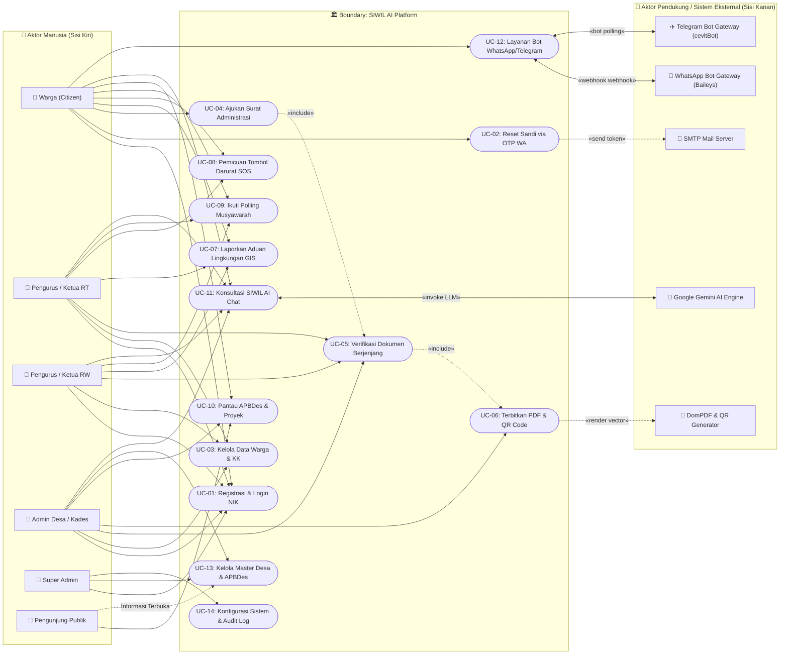
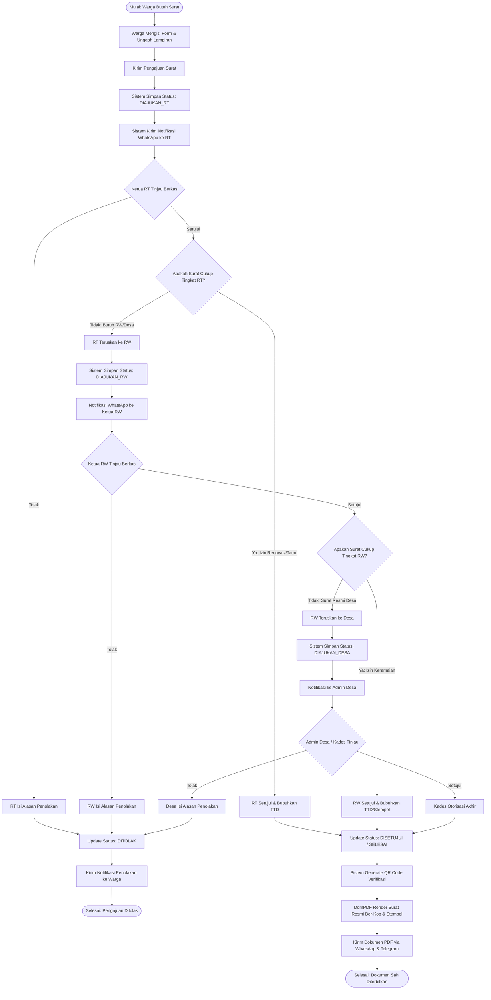
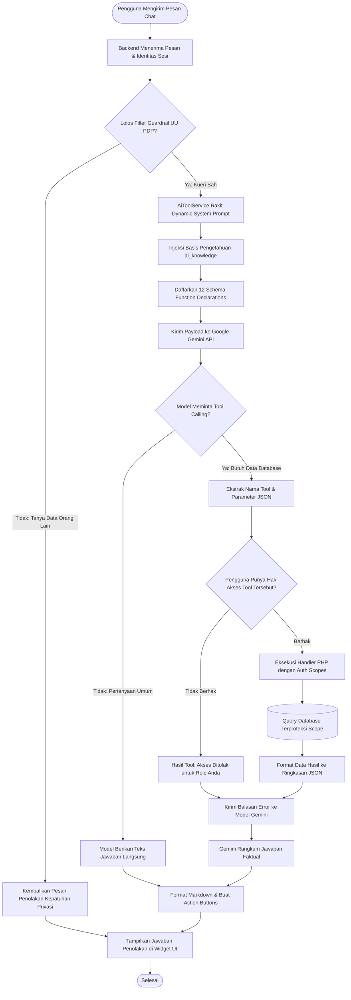
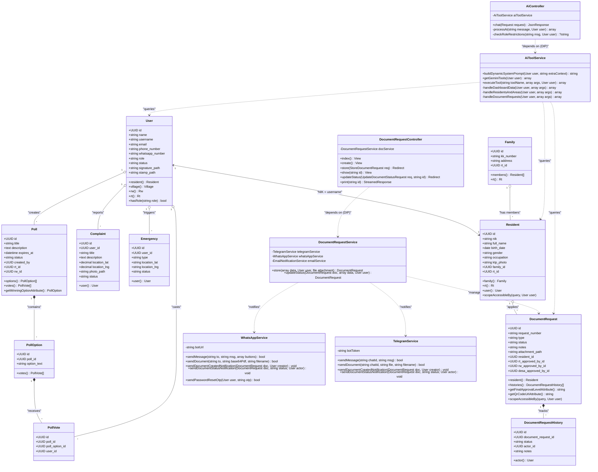
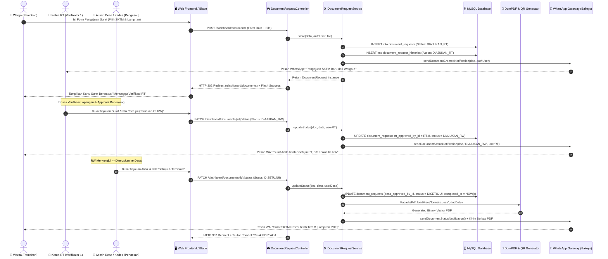
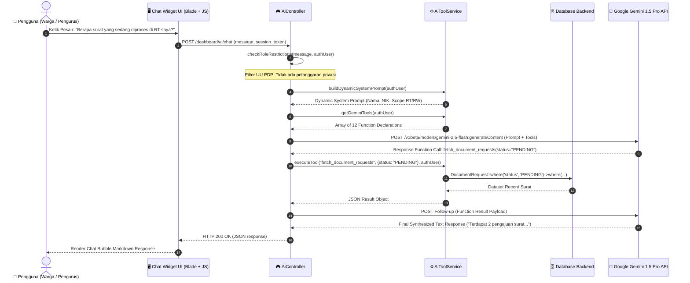
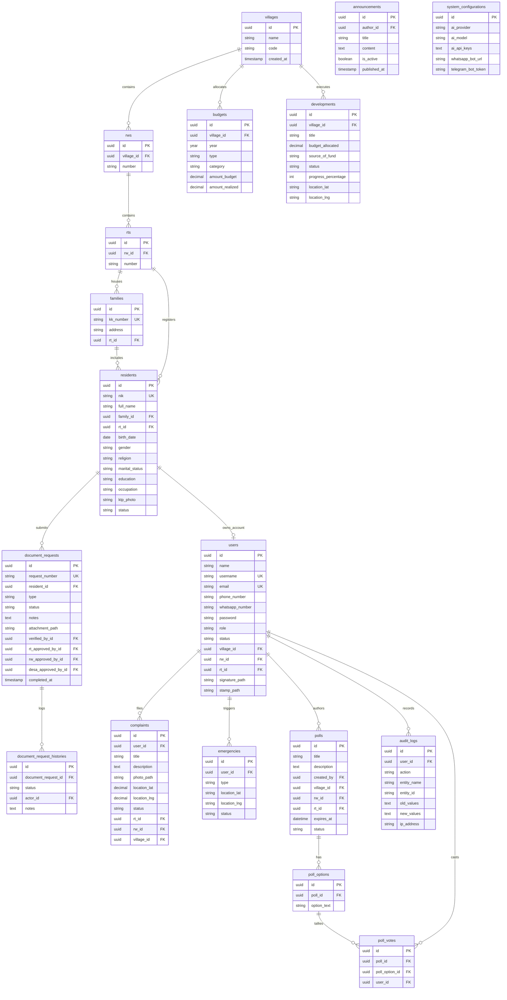

# SYSTEM DESIGN DOCUMENT (SDD)
## SIWIL AI: Sistem Informasi Wilayah Terpadu Berbasis Kecerdasan Buatan
### Pemodelan Arsitektur Perangkat Lunak, UML Berorientasi Objek (SOLID), ERD & Perancangan UI/UX

---

| Informasi Dokumen | Rincian Desain Sistem |
| :--- | :--- |
| **Nama Proyek** | **SIWIL AI** (*Sistem Informasi Wilayah Terpadu*) |
| **Nomor Dokumen** | SDD-SIWIL-2026-V1.0 |
| **Mata Kuliah** | Rekayasa Perangkat Lunak (TIKB2503021) — Semester 3 |
| **Institusi** | Program Studi S1 Teknik Informatika, STMIK IKMI Cirebon |
| **Tahapan SDLC** | Tahap 2: Perancangan UML & Arsitektur Sistem Mandiri (SDD) |
| **Status Dokumen** | *Approved Architecture & Design Baseline* |
| **Versi Dokumen** | 1.0 (Comprehensive UML, SOLID, ERD & UI/UX Edition) |

---

## DAFTAR ISI

1. [PENDAHULUAN & PRINSIP ARSITEKTUR](#1-pendahuluan--prinsip-arsitektur)
   - 1.1 [Tujuan Dokumen](#11-tujuan-dokumen)
   - 1.2 [Penerapan Prinsip Clean Architecture & SOLID](#12-penerapan-prinsip-clean-architecture--solid)
   - 1.3 [Gaya Arsitektur Perangkat Lunak (Layered MVC with Services)](#13-gaya-arsitektur-perangkat-lunak-layered-mvc-with-services)
2. [DIAGRAM UML 1: USE CASE DIAGRAM & SKENARIO LENGKAP](#2-diagram-uml-1-use-case-diagram--skenario-lengkap)
   - 2.1 [Deskripsi Use Case Model](#21-deskripsi-use-case-model)
   - 2.2 [Visualisasi Diagram Use Case](#22-visualisasi-diagram-use-case)
   - 2.3 [Tabel Skenario Use Case Rinci (Core Use Cases)](#23-tabel-skenario-use-case-rinci-core-use-cases)
3. [DIAGRAM UML 2: ACTIVITY DIAGRAM ALUR BISNIS & AI](#3-diagram-uml-2-activity-diagram-alur-bisnis--ai)
   - 3.1 [Activity Diagram Alur Bisnis: Pengajuan & Pengesahan Surat Berjenjang](#31-activity-diagram-alur-bisnis-pengajuan--pengesahan-surat-berjenjang)
   - 3.2 [Activity Diagram Alur AI: Inferensi Cerdas & Eksekusi Function Calling](#32-activity-diagram-alur-ai-inferensi-cerdas--eksekusi-function-calling)
   - 3.3 [Activity Diagram: Panggilan Darurat (SOS Panic Button)](#33-activity-diagram-panggilan-darurat-sos-panic-button)
4. [DIAGRAM UML 3: CLASS DIAGRAM BERORIENTASI OBJEK (SOLID PRINCIPLES)](#4-diagram-uml-3-class-diagram-berorientasi-objek-solid-principles)
   - 4.1 [Penerapan Prinsip SOLID pada Struktur Kelas](#41-penerapan-prinsip-solid-pada-struktur-kelas)
   - 4.2 [Visualisasi Class Diagram Lengkap](#42-visualisasi-class-diagram-lengkap)
   - 4.3 [Daftar Kelas, Atribut, Metode & Relasi Antar-Kelas](#43-daftar-kelas-atribut-metode--relasi-antar-kelas)
5. [DIAGRAM UML 4: SEQUENCE DIAGRAM PERTUKARAN PESAN](#5-diagram-uml-4-sequence-diagram-pertukaran-pesan)
   - 5.1 [Sequence Diagram 1: Alur Layanan Persuratan Berjenjang & Digital Stamp](#51-sequence-diagram-1-alur-layanan-persuratan-berjenjang--digital-stamp)
   - 5.2 [Sequence Diagram 2: Alur Pemrosesan AI Chat & Function Calling Backend](#52-sequence-diagram-2-alur-pemrosesan-ai-chat--function-calling-backend)
   - 5.3 [Sequence Diagram 3: Alur Pemulihan Sandi via WhatsApp OTP](#53-sequence-diagram-3-alur-pemulihan-sandi-via-whatsapp-otp)
6. [DESAIN BASIS DATA RELASIONAL (ENTITY RELATIONSHIP DIAGRAM / ERD)](#6-desain-basis-data-relasional-entity-relationship-diagram--erd)
   - 6.1 [Visualisasi ERD Tingkat Konseptual & Fisik](#61-visualisasi-erd-tingkat-konseptual--fisik)
   - 6.2 [Kamus Data Rinci (Data Dictionary)](#62-kamus-data-rinci-data-dictionary)
7. [PERANCANGAN PROTOTIPE INTERAKTIF UI/UX FIGMA](#7-perancangan-prototipe-interaktif-uiux-figma)
   - 7.1 [Design System & Panduan Gaya (Typography, Color Palette, Grid)](#71-design-system--panduan-gaya-typography-color-palette-grid)
   - 7.2 [Struktur Hierarki Informasi (Information Architecture)](#72-struktur-hierarki-informasi-information-architecture)
   - 7.3 [Spesifikasi Wireframe Antarmuka Kunci](#73-spesifikasi-wireframe-antarmuka-kunci)
   - 7.4 [Panduan Walkthrough Prototipe untuk Presentasi Video 2](#74-panduan-walkthrough-prototipe-untuk-presentasi-video-2)
8. [BERKAS DIAGRAM DRAW.IO XML](#8-berkas-diagram-drawio-xml)

---

## 1. PENDAHULUAN & PRINSIP ARSITEKTUR

### 1.1 Tujuan Dokumen
Dokumen *System Design Document* (SDD) ini menyajikan spesifikasi arsitektur teknis menyeluruh dari aplikasi **SIWIL AI**. Dokumen ini mentranslasikan spesifikasi kebutuhan pada SRS/PRD ke dalam pemodelan visual berstandar UML 2.5, perancangan basis data relasional ternormalisasi (3NF), serta cetak biru antarmuka pengguna (UI/UX) untuk memenuhi kriteria penilaian mutu luaran rekayasa perangkat lunak.

### 1.2 Penerapan Prinsip Clean Architecture & SOLID
Struktur sistem SIWIL AI dibangun dengan kepatuhan ketat terhadap prinsip **SOLID**:
1. **Single Responsibility Principle (SRP):** Setiap controller dan service hanya memiliki satu tanggung jawab spesifik. Contoh: `DocumentRequestService` mengelola logika persuratan murni, sementara `TelegramService` dan `WhatsAppService` hanya mengurusi protokol komunikasi pengiriman pesan.
2. **Open/Closed Principle (OCP):** Fitur verifikasi dokumen dan pengiriman notifikasi terbuka untuk penambahan kanal baru tanpa memodifikasi basis kode inti persuratan.
3. **Liskov Substitution Principle (LSP):** Model entitas kependudukan dan pengguna (`User`, `Resident`, `Family`) mengimplementasikan kontrak relasi Eloquent standar yang dapat dipertukarkan dalam antarmuka query scopes (`scopeAccessibleBy`).
4. **Interface Segregation Principle (ISP):** Kontrak fungsi bot memisahkan antarmuka perpesanan teks sederhana dengan pengiriman dokumen biner (PDF).
5. **Dependency Inversion Principle (DIP):** Modul tingkat tinggi (Controller) bergantung pada abstraksi layanan (`Service Layer`) melalui *Dependency Injection* pada konstruktor, bukan instansiasi objek langsung.

### 1.3 Gaya Arsitektur Perangkat Lunak (Layered MVC with Services)

```
┌────────────────────────────────────────────────────────────────────────┐
│                   PRESENTATION LAYER (Blade + Tailwind v4)              │
│  - Public Portal Views       - Citizen Dashboard (Mobile-First)        │
│  - Admin/RT/RW Dashboard     - Interactive Modals & Canvas GIS Map     │
└───────────────────────────────────┬────────────────────────────────────┘
                                    │ HTTP / JSON Requests
┌───────────────────────────────────▼────────────────────────────────────┐
│                    HTTP & ROUTING LAYER (Laravel Web/API)              │
│  - Authenticate Middleware   - ProfileComplete Middleware              │
│  - RolePermission Middleware - FormRequest Validators (CSRF + Regex)   │
└───────────────────────────────────┬────────────────────────────────────┘
                                    │ Validated DTO / Request
┌───────────────────────────────────▼────────────────────────────────────┐
│                      APPLICATION CONTROLLERS LAYER                      │
│  - AuthController            - DocumentRequestController               │
│  - AiController              - SpatialAnalyticsController              │
│  - EmergencyController       - WhatsAppController / TelegramController │
└───────────────────────────────────┬────────────────────────────────────┘
                                    │ Service Invocation
┌───────────────────────────────────▼────────────────────────────────────┐
│                  DOMAIN BUSINESS LOGIC & SERVICE LAYER                  │
│  - AiToolService (Prompt + Guardrail + Tool Dispatcher)                 │
│  - DocumentRequestService (Multi-Tier Approval Engine)                  │
│  - WhatsAppService & TelegramService (Omnichannel Message Gateway)      │
│  - ResidentService & EmailNotificationService                           │
└───────────────────────────────────┬────────────────────────────────────┘
                                    │ Eloquent ORM Operations
┌───────────────────────────────────▼────────────────────────────────────┐
│                   PERSISTENCE & DATA ACCESS LAYER                      │
│  - Eloquent Models (20 Domain Entities with HasUuids)                  │
│  - Scopes: scopeAccessibleBy (Strict RBAC & UU PDP Enforcement)        │
│  - Database (MySQL / MariaDB / SQLite) + File Storage (Disk Public)    │
└────────────────────────────────────────────────────────────────────────┘
```

---

## 2. DIAGRAM UML 1: USE CASE DIAGRAM & SKENARIO LENGKAP

### 2.1 Deskripsi Use Case Model
Use Case model SIWIL AI membagi fungsionalitas sistem ke dalam 4 subsistem utama:
1. **Subsistem Kependudukan & Wilayah:** Melayani pendaftaran akun, validasi data NIK, struktur KK, dan pengelolaan RT/RW.
2. **Subsistem Pelayanan Warga (Civic Services):** Melayani persuratan berjenjang, pelaporan aduan berbasis lokasi, dan sinyal darurat SOS.
3. **Subsistem E-Demokrasi & Transparansi:** Melayani pemungutan suara musyawarah, portal APBDes, dan monitoring pembangunan fisik.
4. **Subsistem Kecerdasan Buatan & Omnichannel:** Melayani percakapan cerdas SIWIL AI, function calling, dan interaksi bot pesan instan.

### 2.2 Visualisasi Diagram Use Case

> [!TIP]
> File XML Draw.io resmi untuk diagram ini tersedia di [usecase_diagram.drawio](file:///c:/Users/alfar/Documents/laragon/www/siwil/usecase_diagram.drawio) atau workbook gabungan [siwil_architecture_all.drawio](file:///c:/Users/alfar/Documents/laragon/www/siwil/siwil_architecture_all.drawio) dengan pemisahan tegas: **Aktor Manusia di Kiri** dan **Aktor Pendukung / Eksternal di Kanan**.



### 2.3 Tabel Skenario Use Case Rinci (Core Use Cases)

#### Skenario Use Case UC-04 & UC-05: Pengajuan & Pengesahan Surat Berjenjang
* **Kode Use Case:** `UC-SRT-01`
* **Nama Use Case:** Pengajuan dan Verifikasi Persuratan Berjenjang
* **Aktor Utama:** Warga, Ketua RT, Ketua RW, Admin Desa / Kepala Desa
* **Prakondisi (*Preconditions*):** Warga telah login dengan akun berstatus aktif, biodata NIK terdaftar, dan data profil lengkap.
* **Pascakondisi (*Postconditions*):** Dokumen berstatus `DISETUJUI/SELESAI`, vector PDF resmi tersimpan dan siap diunduh, stempel/TTD digital tersemat, serta notifikasi terkirim ke WhatsApp warga.
* **Alur Utama (Main Flow):**
  1. Warga membuka menu "Pengajuan Surat" dan memilih jenis surat (contoh: *Surat Keterangan Tidak Mampu / SKTM*).
  2. Warga mengisi keperluan, melampirkan berkas bukti (KTP/KK), dan menekan tombol kirim.
  3. Sistem membuat ID pengajuan (`SRT-YYYYMMDD-XXXX`), status diset ke `DIAJUKAN_RT`, dan mencatat riwayat ke `document_request_histories`.
  4. Sistem mengirimkan notifikasi pesan ke WhatsApp/Telegram Ketua RT yang bersangkutan.
  5. Ketua RT masuk ke dashboard, memeriksa permohonan warga, dan menekan tombol "Setujui (Teruskan ke RW)".
  6. Sistem menyematkan identitas verifikator RT (`rt_approved_by_id`), TTD RT, dan memperbarui status menjadi `DIAJUKAN_RW`.
  7. Ketua RW meninjau surat di dashboard RW, lalu menekan tombol "Setujui (Teruskan ke Desa)".
  8. Sistem menyematkan identitas verifikator RW (`rw_approved_by_id`) dan status berubah menjadi `DIAJUKAN_DESA`.
  9. Admin Desa / Kepala Desa memeriksa kelengkapan surat di dashboard desa dan menekan tombol "Setujui & Terbitkan Surat".
  10. Sistem menyematkan stempel dinas desa, TTD Kepala Desa, menyusun QR Code verifikasi unik, dan mengubah status menjadi `DISETUJUI`.
  11. Mesin DomPDF merender berkas surat resmi menjadi vector PDF ber-kop surat.
  12. Sistem memicu WhatsApp & Telegram Service untuk mengirimkan tautan unduhan dan berkas PDF ke ponsel warga.
* **Alur Alternatif (Alternative Flows):**
  * *4a. Dokumen Berhenti di Tingkat RT:* Jika jenis surat adalah tingkat RT (contoh: *Izin Renovasi Rumah*), Ketua RT langsung menekan "Setujui & Selesai". Status langsung berubah ke `DISETUJUI` tanpa melewati RW/Desa.
  * *5a. Pengajuan Ditolak oleh RT/RW/Desa:* Verifikator menekan tombol "Tolak", memasukkan alasan penolakan pada kotak dialog. Status berubah menjadi `DITOLAK`, dan pemohon menerima notifikasi WhatsApp beserta alasan penolakan.

#### Skenario Use Case UC-11: Konsultasi Cerdas SIWIL AI (Function Calling)
* **Kode Use Case:** `UC-AI-01`
* **Nama Use Case:** Konsultasi Layanan & Eksekusi Tool Cerdas SIWIL AI
* **Aktor Utama:** Warga, Pengurus Wilayah (RT/RW/Desa)
* **Prakondisi:** Pengguna telah terautentikasi dalam sesi web aktif.
* **Pascakondisi:** Pengguna menerima jawaban akurat berbasis data faktual sistem tanpa pelanggaran privasi data kependudukan.
* **Alur Utama (Main Flow):**
  1. Pengguna membuka widget obrolan SIWIL AI di pojok kanan bawah dashboard.
  2. Pengguna mengetik pertanyaan: *"Bagaimana status pengajuan surat SKTM saya?"*
  3. Controller `AiController` mengaktifkan `AiToolService` dan menginjeksikan Dynamic System Prompt berisi identitas sesi pengguna (Nama, NIK, Peran, RT/RW).
  4. Controller menjalankan filter deterministik UU PDP untuk memastikan kueri tidak meminta data sensitif pihak ketiga.
  5. Pesan diteruskan ke Google Gemini API bersama dengan deklarasi 12 *function tools*.
  6. Model Gemini mengenali intensi pengguna dan mengembalikan respons `tool_call`: `fetch_document_requests(status="all")`.
  7. Backend mengeksekusi `AiToolService::executeTool`, mengambil data pengajuan milik NIK pengguna aktif dari database.
  8. Data hasil kueri dikirimkan kembali ke Gemini API sebagai hasil eksekusi fungsi.
  9. Gemini API merumuskan jawaban berbahasa manusia yang ramah, ringkas, dan faktual.
  10. Widget menampilkan jawaban kepada pengguna disertai tombol aksi cepat (contoh: *"Lihat Detail Surat"*).
* **Alur Alternatif (Alternative Flow - Pelanggaran UU PDP):**
  * *4a. Kueri Melanggar UU PDP:* Warga bertanya: *"Berapa nomor telepon dan alamat Pak Joko warga RT 02?"*.
  * *4b. Penolakan Deterministik:* Filter backend mendeteksi permintaan data pribadi warga lain. Sistem langsung memotong aliran dan mengembalikan pesan penolakan sopan tanpa memanggil API pihak ketiga.

---

## 3. DIAGRAM UML 2: ACTIVITY DIAGRAM ALUR BISNIS & AI

### 3.1 Activity Diagram Alur Bisnis: Pengajuan & Pengesahan Surat Berjenjang



### 3.2 Activity Diagram Alur AI: Inferensi Cerdas & Eksekusi Function Calling



---

## 4. DIAGRAM UML 3: CLASS DIAGRAM BERORIENTASI OBJEK (SOLID PRINCIPLES)

### 4.1 Penerapan Prinsip SOLID pada Struktur Kelas
Class diagram SIWIL AI dirancang untuk memisahkan logika antarmuka, orkestrasi bisnis, dan akses data secara modular:
- **Interfaces / Abstraksi:** `DocumentServiceInterface`, `NotificationChannelInterface`, `AiEngineInterface`.
- **Services (Business Layer):** `DocumentRequestService`, `AiToolService`, `WhatsAppService`, `TelegramService`, `ResidentService`.
- **Controllers (Presentation Orchestration):** Menangani validasi input, status HTTP, dan merender tampilan Blade.
- **Models (Domain Layer):** Membungkus entitas tabel, mutator, casting, dan query scopes keamanan (`scopeAccessibleBy`).

### 4.2 Visualisasi Class Diagram Lengkap



---

## 5. DIAGRAM UML 4: SEQUENCE DIAGRAM PERTUKARAN PESAN

> [!TIP]
> File XML Draw.io resmi untuk diagram sequence tersedia di [sequence_diagram.drawio](file:///c:/Users/alfar/Documents/laragon/www/siwil/sequence_diagram.drawio) atau workbook gabungan [siwil_architecture_all.drawio](file:///c:/Users/alfar/Documents/laragon/www/siwil/siwil_architecture_all.drawio) dengan 10 lifeline terstruktur: **Aktor Manusia di Lifeline Kiri**, **Core System di Lifeline Tengah**, dan **Aktor Pendukung di Lifeline Kanan**.

### 5.1 Sequence Diagram 1: Alur Layanan Persuratan Berjenjang & Digital Stamp



### 5.2 Sequence Diagram 2: Alur Pemrosesan AI Chat & Function Calling Backend


    TS->>DB: DocumentRequest::accessibleBy(authUser)->where('status', 'PENDING')->get()
    DB-->>TS: Collection Data Surat (3 Dokumen di RT yang bersangkutan)
    TS-->>AC: JSON Result: {total: 3, items: [...]}
    
    AC->>LLM: POST Return Function Result (Tool Output)
    LLM-->>AC: Final Text Response: "Saat ini ada 3 pengajuan surat yang sedang menunggu verifikasi di wilayah Anda..."
    AC-->>UI: HTTP 200 JSON ({message: "...", options: [...]})
    UI-->>U: Render Pesan Balasan Ramah + Tombol Pintasan ke Menu Dokumen
```

---

## 6. DESAIN BASIS DATA RELASIONAL (ENTITY RELATIONSHIP DIAGRAM / ERD)

### 6.1 Visualisasi ERD Tingkat Konseptual & Fisik



---

## 7. PERANCANGAN PROTOTIPE INTERAKTIF UI/UX FIGMA

### 7.1 Design System & Panduan Gaya
* **Palet Warna Utama (Color System):**
  * `Primary (Emerald/Green)`: `#10B981` (Melambangkan pelayanan publik, kesejahteraan desa, dan kejelasan status).
  * `Primary Dark`: `#047857` (Kontras teks tombol & sidebar aktif).
  * `Danger / Emergency Red`: `#EF4444` (Warna khusus tombol SOS, status darurat aktif, dan penolakan berkas).
  * `Warning / Pending Amber`: `#F59E0B` (Warna status dokumen sedang diverifikasi / antrean).
  * `Info / Process Blue`: `#3B82F6` (Warna status pengaduan dalam pengerjaan & pengumuman warta).
  * `Neutral / Surface Dark`: `#0F172A` (Latar belakang sidebar dan teks tajam).
  * `Surface Light / Canvas`: `#F8FAFC` (Latar belakang kerja utama aplikasi).
* **Tipografi:** Keluarga font `Inter` / `Plus Jakarta Sans` dengan skala hierarki:
  * H1 (Judul Halaman): `24px` - SemiBold (600)
  * H2 (Sub-judul / Judul Kartu): `18px` - Medium (500)
  * Body Text: `14px` - Regular (400)
  * Caption & Badge Status: `12px` - SemiBold (600)
* **Aturan Tata Letak & Grid:**
  * Desktop Dashboard: 12-kolom Grid dengan sidebar tetap 260px di kiri.
  * Mobile Warga: 1-kolom Fluid Layout dengan navigasi bawah (*Bottom Navigation Bar*) dan kartu informasi bertumpuk vertikal.

### 7.2 Struktur Hierarki Informasi (Information Architecture)
1. **Portal Publik (Unauthenticated):**
   * `/` $\to$ Beranda Profil Wilayah, Ringkasan Statistik, Warta Terkini.
   * `/portal/apbdes` $\to$ Transparansi APBDes & Realisasi Anggaran.
   * `/portal/pembangunan` $\to$ Galeri Proyek Pembangunan Fisik & Titik Peta.
   * `/portal/statistik` $\to$ Piramida Penduduk, Sebaran Gender, dan Pendidikan.
2. **Dashboard Warga (`/dashboard`):**
   * Metrik Status Surat Saya (Pending, Selesai, Ditolak).
   * Tombol Aksi Cepat: Buat Surat Baru, Lapor Masalah Lingkungan, Tombol SOS.
   * Widget Musyawarah/Polling Aktif dengan Tombol Voting Langsung.
   * Widget Warta & Pengumuman Desa Terkini.
   * Float Button: Asisten Cerdas SIWIL AI.
3. **Dashboard Pengurus RT/RW/Desa (`/dashboard`):**
   * Metrik Yurisdiksi: Total Warga, Total KK, Surat Butuh Tindakan, Aduan Masuk.
   * Antrean Surat Masuk dengan Tombol Verifikasi Cepat.
   * Peta Pemantauan Spasial: Titik Aduan Warga & Titik Darurat Aktif.
   * Manajemen Data Kependudukan & Pendaftaran Akun Warga Baru.

### 7.3 Panduan Walkthrough Prototipe untuk Presentasi Video 2
Pada perekaman video evaluasi tahap 2 (durasi 5–7 menit), walkthrough prototipe Figma wajib membedah 3 alur utama:
1. **Flow 1 - Pengajuan Surat Mandiri Warga:** Demonstrasi pemilihan surat SKTM $\to$ Pengisian form $\to$ Tinjauan status di dashboard $\to$ Unduh berkas PDF yang telah memiliki tanda tangan digital dan QR Code.
2. **Flow 2 - Verifikasi Berjenjang Pengurus:** Demonstrasi pergantian peran (*Role Switching*) dari RT yang meneruskan surat $\to$ RW yang memverifikasi $\to$ Kepala Desa yang menyetujui akhir.
3. **Flow 3 - Interaksi Asisten SIWIL AI:** Demonstrasi pembukaan modal chat $\to$ Pengetikan pertanyaan status surat $\to$ Eksekusi function calling $\to$ Penyajian data live dari database ke balon percakapan.

---

## 8. BERKAS DIAGRAM DRAW.IO XML

Untuk memastikan portabilitas, standarisasi akademik, dan kemudahan evaluasi, seluruh diagram pada dokumen SDD ini telah diekspor ke dalam berkas standar **draw.io XML (`.drawio`)** dengan aturan baku: **Aktor Manusia di Kiri**, **Boundary/Sistem Inti di Tengah**, dan **Aktor Pendukung / Eksternal di Kanan**, dengan koordinat presisi dan tata letak garis penghubung ortogonal yang rapi tanpa saling menutupi (*zero line collision*):

1. 📄 **[usecase_diagram.drawio](file:///c:/Users/alfar/Documents/laragon/www/siwil/usecase_diagram.drawio)** — Use Case Diagram Lengkap (6 Aktor Manusia di Kiri, 5 Aktor Pendukung di Kanan, 24 use cases terkelompok).
2. 📄 **[activity_diagram.drawio](file:///c:/Users/alfar/Documents/laragon/www/siwil/activity_diagram.drawio)** — Activity Diagram 7 Swimlane (Warga, RT, RW, Desa di Kiri, Backend di Tengah, DomPDF & WhatsApp Bot di Kanan).
3. 📄 **[class_diagram.drawio](file:///c:/Users/alfar/Documents/laragon/www/siwil/class_diagram.drawio)** — Class Diagram 3 Package Berorientasi Objek (Controllers/Manusia di Kiri, Domain/Services di Tengah, External Gateways di Kanan - SOLID Compliant).
4. 📄 **[sequence_diagram.drawio](file:///c:/Users/alfar/Documents/laragon/www/siwil/sequence_diagram.drawio)** — Sequence Diagram Pertukaran Pesan (4 Aktor Manusia di Lifeline Kiri, Core Systems di Tengah, 2 Aktor Pendukung di Kanan).
5. 📄 **[erd_diagram.drawio](file:///c:/Users/alfar/Documents/laragon/www/siwil/erd_diagram.drawio)** — Entity Relationship Diagram Basis Data Relasional 18 Entitas (Data Manusia & Wilayah di Kiri, Transaksi di Tengah, Sistem Pendukung/AI di Kanan).
6. 📦 **[siwil_architecture_all.drawio](file:///c:/Users/alfar/Documents/laragon/www/siwil/siwil_architecture_all.drawio)** — **Workbook Lengkap (Multi-Tab)** yang menggabungkan seluruh kelima diagram di atas ke dalam satu file terpadu siap pakai di aplikasi Draw.io / diagrams.net.

---

## 9. PENGESAHAN DOKUMEN ARSITEKTUR

Dokumen Spesifikasi Desain Sistem (SDD) ini dinyatakan sah dan memenuhi kriteria penilaian mutu pemodelan perangkat lunak Tahap 2 Proyek Akhir Mandiri Rekayasa Perangkat Lunak.

*Ditetapkan di: Cirebon*  
*Tanggal: 12 November 2026*  
*Penulis Dokumen: Mahasiswa S1 Teknik Informatika (Full-Stack Engineer)*

